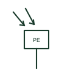

# Photoelectric light switch plan mark

Plan mark for a light-sensitive switch that turns external or perimeter lighting on at dusk and off at dawn.

[Canonical reference](https://eloragrid.ai/symbols/iec-photoelectric-light-switch) · [Structured record](../entries/iec-photoelectric-light-switch.json) · [All references](README.md)

Updated: 2026-10-28. Drawing use: GA. Reference families: IEC.

Graphical convention: IEC. Light-sensitive switch.

## What it represents

A photoelectric switch, or photocell, measures ambient light and operates a lighting circuit at a set lux threshold. Plans draw a small switch or box with inward arrows to indicate light received, placed where the cell can see the sky without seeing the luminaires it controls.
Photocells are often combined with time switches so that lighting comes on at dusk but goes off at a fixed time. The plan and schedule should show both devices and their logic.
The mark does not give the threshold, time delay or contactor rating. Large lighting loads are usually switched by a contactor operated by the cell.

## How to read it

- Check the cell location for a clear view of daylight.
- Look for a contactor or time switch in the same control scheme.

## Drawing checklist

- State lux setting range.
- Show associated contactor or time switch.
- Orient the cell away from controlled luminaires.

## Important distinction

A light-dependent resistor is a component; a photoelectric switch is a complete lighting control device on the plan.

## Facts

- Input: Ambient daylight level
- Common pairing: Time switch and lighting contactor
- Exact standard graphic: Not reproduced here; confirm the form against IEC 60617 and the project legend

## Public references

- [IEC graphical symbols for diagrams](https://tc3.iec.ch/tc-activity/graphical-symbols-for-diagrams/) — IEC. IEC graphical symbol context; independently drawn here.
- [Autodesk IEC-60617 preview: Radiation qualifiers](https://help.autodesk.com/cloudhelp/2021/ENU/AutoCAD-Electrical/files/GUID-EABC81B4-549D-49C9-A0F5-086DD204A689.htm) — Autodesk. Public IEC-oriented radiation qualifier family for the received-light arrows.

## Related references

- [Light-dependent resistor](light-dependent-resistor.md)
- [Time switch plan mark](iec-time-switch-plan-mark.md)
- [Lighting presence detector plan mark](iec-presence-detector-lighting.md)

Original educational concept geometry, CC BY 4.0. Unitless; not a certified standards glyph or manufacturer footprint.

Elora-authored explanations are CC BY 4.0. Linked standards and manufacturer material retain their own rights. Confirm project requirements using primary sources.
