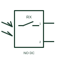

# IEC photoelectric receiver: normally open receiver 2 wire

Photoelectric receiver form: Normally Open Receiver 2 wire.

[Canonical reference](https://eloragrid.ai/symbols/iec-photoelectric-receiver-normally-open-receiver-2-wire) · [Structured record](../entries/iec-photoelectric-receiver-normally-open-receiver-2-wire.json) · [All references](README.md)

Updated: 2026-10-28. Drawing use: Schematic. Reference families: IEC, Manufacturer.

Graphical convention: IEC. Normally Open Receiver 2 wire.

## What it represents

A photoelectric receiver evaluates light arriving from an associated emitter and provides the documented electrical response. This entry identifies the normally open receiver 2 wire form in the publisher's IEC-context family.
An object crossing a conveyor beam can change the receiver output. The receiver tag should identify its optical partner and the controller input receiving its signal. The normally-open designation starts with a non-conducting output or open contact in the documented reference condition; operation changes that state. The two-connection interface must be read with the load and supply arrangement. Leakage current and minimum load can matter where a powered device is connected in series with an input.
Normally-open and normally-closed labels describe the documented electrical output form. They do not by themselves establish light-on or dark-on operation; confirm that setting with the device data.

## How to read it

- The normally-open designation starts with a non-conducting output or open contact in the documented reference condition; operation changes that state.
- The two-connection interface must be read with the load and supply arrangement. Leakage current and minimum load can matter where a powered device is connected in series with an input.
- Normally-open and normally-closed labels describe the documented electrical output form. They do not by themselves establish light-on or dark-on operation; confirm that setting with the device data.

## Drawing checklist

- Identify the target, sensing mode and expected normal condition.
- Label supply, output and connector pins from the actual device diagram.
- Reference output circuit type, operating range and controller input.

## Important distinction

This entry adds the normally open receiver 2 wire detail to the broader photoelectric receiver family. Normally-open and normally-closed labels describe the documented electrical output form. They do not by themselves establish light-on or dark-on operation; confirm that setting with the device data.

## Facts

- Drawing form: Normally Open Receiver 2 wire
- Public vendor block names: HPE11PE2 / VPE11PE2. Autodesk identifiers, not standards database IDs.
- Drawing purpose: photoelectric receiver
- Graphic scope: Independently authored educational illustration; not certified standard geometry, a terminal pinout or a product footprint.

## Public references

- [Autodesk IEC-60617 Symbol Preview: Photoelectric Receiver Switches](https://help.autodesk.com/cloudhelp/2021/ENU/AutoCAD-Electrical/files/GUID-7F8E27FB-B7DF-44CF-957F-0231B0F0B0D0.htm) — Autodesk. Public Photoelectric Receiver Switches table explicitly lists HPE11PE2 / VPE11PE2 with this operating or connection form. Vendor graphics are linked, not copied.

## Related references

- [Photoelectric emitter-receiver switch](photoelectric-emitter-receiver-switch.md)
- [PLC digital input](plc-digital-input.md)
- [Terminal connection](terminal.md)

Original educational concept geometry, CC BY 4.0. Unitless; not a certified standards glyph or manufacturer footprint.

Elora-authored explanations are CC BY 4.0. Linked standards and manufacturer material retain their own rights. Confirm project requirements using primary sources.
