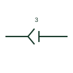

# Plug and jack with common pin number

A plug and jack pair carrying one shared pin number for both halves rather than separate numbers on each half.

[Canonical reference](https://eloragrid.ai/symbols/iec-plug-jack-common-pin-number) · [Structured record](../entries/iec-plug-jack-common-pin-number.json) · [All references](README.md)

Updated: 2026-10-28. Drawing use: Schematic. Reference families: IEC, Manufacturer.

Graphical convention: IEC. Plug/Jack with common pin number.

## What it represents

Some connector symbols carry a single pin number shared by both mating halves, because the pin and socket on a given contact position carry the same number in the connector insert. This keeps schematics uncluttered and matches how most connector manufacturers number inserts.
The common number assumes both halves use matching numbering. Where a harness connector is mated to a board header with different numbering, separate pin numbers are needed. This is a publisher drafting variant, so the underlying connection meaning is the same as an ordinary plug and socket pair.

## How to read it

- Confirm both halves use the same pin numbering scheme.
- Read the pin number once for both halves.

## Drawing checklist

- Use common numbering only where the inserts match.
- Keep the connector tag on the symbol.
- Switch to separate numbers for mismatched pairs.

## Important distinction

The common pin number form carries one number for both halves; the standard pair can carry different numbers per half.

## Facts

- Graphic cue: Plug and jack pair with one pin number between them
- Publisher form: Plug/Jack (common pin number), Autodesk IEC-60617 preview
- Preview: Original educational illustration; consult the publisher and applicable standard for the exact graphic

## Public references

- [AutoCAD Electrical: Connectors](https://help.autodesk.com/cloudhelp/2021/ENU/AutoCAD-Electrical/files/GUID-7175D293-9F4C-485C-8E2D-DE684820D53B.htm) — Autodesk. Public IEC-oriented preview listing the common pin number plug and jack form.
- [Autodesk IEEE Symbol Preview — Connectors - No Wirenumber Changes](https://help.autodesk.com/cloudhelp/2021/ENU/AutoCAD-Electrical/files/GUID-0B14FEAB-110A-4DD3-884E-0A2F8F9E76F7.htm) — Autodesk. Public IEEE-oriented preview of the same connector family.

## Related references

- [Plug and socket connector pair](plug-and-socket-connector-pair.md)
- [Additional connector pin](iec-additional-connector-pin.md)
- [Connector retaining wire identity](iec-connector-retaining-wire-identity.md)

Original educational concept geometry, CC BY 4.0. Unitless; not a certified standards glyph or manufacturer footprint.

Elora-authored explanations are CC BY 4.0. Linked standards and manufacturer material retain their own rights. Confirm project requirements using primary sources.
