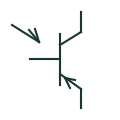

# IEC PNP phototransistor: photosensitive pnp transistor

PNP phototransistor form: Photosensitive PNP Transistor.

[Canonical reference](https://eloragrid.ai/symbols/iec-pnp-phototransistor-photosensitive-pnp-transistor) · [Structured record](../entries/iec-pnp-phototransistor-photosensitive-pnp-transistor.json) · [All references](README.md)

Updated: 2026-10-28. Drawing use: Schematic. Reference families: IEC, Manufacturer.

Graphical convention: IEC. Photosensitive PNP Transistor.

## What it represents

A PNP phototransistor uses incident light to control a PNP transistor current path. The emitter arrow and supply orientation distinguish it from the NPN form. This entry identifies the photosensitive pnp transistor form in the publisher's IEC-context family.
A light-sensitive input stage can feed a conditioning circuit without a separately driven base connection. Check the emitter and collector assignments before following the measurement current. 
A PNP phototransistor is different from a photodiode: its transistor action adds current gain, with different speed and bias requirements.

## How to read it

- A light-sensitive input stage can feed a conditioning circuit without a separately driven base connection. Check the emitter and collector assignments before following the measurement current.
- A PNP phototransistor is different from a photodiode: its transistor action adds current gain, with different speed and bias requirements.

## Drawing checklist

- Identify terminal polarity and the required bias region.
- Reference the selected component characteristics and package pinout.
- Show the surrounding bias and signal-conditioning network.

## Important distinction

This entry adds the photosensitive pnp transistor detail to the broader PNP phototransistor family. A PNP phototransistor is different from a photodiode: its transistor action adds current gain, with different speed and bias requirements.

## Facts

- Drawing form: Photosensitive PNP Transistor
- Public vendor block names: HDV1B6 / VDV1B6. Autodesk identifiers, not standards database IDs.
- Drawing purpose: PNP phototransistor
- Graphic scope: Independently authored educational illustration; not certified standard geometry, a terminal pinout or a product footprint.

## Public references

- [AutoCAD Electrical: Semiconductor components](https://help.autodesk.com/cloudhelp/2021/ENU/AutoCAD-Electrical/files/GUID-AC954072-7314-4682-88AF-38160D61E9A2.htm) — Autodesk. Public Semiconductor Components table explicitly lists HDV1B6 / VDV1B6 with this operating or connection form. Vendor graphics are linked, not copied.

## Related references

- [Diode](diode.md)
- [Photodiode](photodiode.md)
- [NPN phototransistor](npn-phototransistor.md)

Original educational concept geometry, CC BY 4.0. Unitless; not a certified standards glyph or manufacturer footprint.

Elora-authored explanations are CC BY 4.0. Linked standards and manufacturer material retain their own rights. Confirm project requirements using primary sources.
