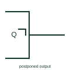

# IEC postponed output qualifier

Angle mark beside an output showing it changes only when the initiating input returns to its original level.

[Canonical reference](https://eloragrid.ai/symbols/iec-postponed-output) · [Structured record](../entries/iec-postponed-output.json) · [All references](README.md)

Updated: 2026-10-28. Drawing use: Schematic. Reference families: IEC, Manufacturer.

Graphical convention: IEC. Angle mark inside the outline next to the output.

## What it represents

The postponed output qualifier is a small right-angle mark inside the outline next to an output. It indicates that the output changes when the input that initiated the change, typically the C input, returns to its initial external state. It identifies pulse-triggered or master-slave flip-flops and data lock-out types.
This matters for timing analysis. On a pulse-triggered device the data must be stable for the whole time the clock is active, whereas on an edge-triggered device only setup and hold around the edge matter. The mark tells the reader which rule applies.
The qualifier does not distinguish a pulse-triggered element from a data lock-out element; the clock input marking does. A dynamic mark on C with a postponed output indicates the data lock-out form.

## How to read it

- Find the mark at each Q output of a flip-flop.
- Check the C input for a dynamic mark to identify the data lock-out type.

## Drawing checklist

- Draw the mark inside the outline at the output.
- Show C input marking consistently.
- Note data stability requirements for pulse-triggered devices.

## Important distinction

An edge-triggered flip-flop has a dynamic C input and no postponed output mark.

## Facts

- Meaning: Output changes when the initiating input returns
- Typical device: Master-slave or pulse-triggered flip-flop
- Artwork scope: Original educational illustration; consult the applicable standard and the selected device documentation for the exact graphic

## Public references

- [Overview of IEEE Standard 91-1984: explanation of logic symbols (SDYZ001A)](https://www.ti.com/lit/ml/sdyz001a/sdyz001a.pdf) — Texas Instruments. Defines the postponed output qualifier and pulse-triggered element behaviour.

## Related references

- [IEC pulse-triggered (master-slave) JK flip-flop](iec-pulse-triggered-jk-flip-flop.md)
- [IEC dynamic input (edge-triggered)](iec-dynamic-input.md)
- [IEC JK flip-flop (rectangular form)](iec-jk-flip-flop.md)

Original educational concept geometry, CC BY 4.0. Unitless; not a certified standards glyph or manufacturer footprint.

Elora-authored explanations are CC BY 4.0. Linked standards and manufacturer material retain their own rights. Confirm project requirements using primary sources.
