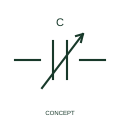

# Preset-adjustable capacitor

This form distinguishes a capacitor with a preset or trim adjustment.

[Canonical reference](https://eloragrid.ai/symbols/iec-preset-adjustable-capacitor) · [Structured record](../entries/iec-preset-adjustable-capacitor.json) · [All references](README.md)

Updated: 2026-10-27. Drawing use: Schematic. Reference families: IEC, Manufacturer.

Graphical convention: IEC. Preset-adjustable capacitor.

## What it represents

This form distinguishes a capacitor with a preset or trim adjustment. A trim or preset adjustment sets the capacitive value for the documented circuit function. The setting interface is different from a continuous operator adjustment in ordinary use.
Identify the adjustment function and the circuit terminals. The component value, range and setting method belong in the equipment or component documentation.

## How to read it

- State how the capacitance setting is specified and which terminals belong to the device.
- A preset adjustment is different from an operator-controlled variable capacitor.

## Drawing checklist

- Identify the associated device, circuit or diagram boundary.
- State how the capacitance setting is specified and which terminals belong to the device.
- Cross-reference the equipment data, terminal mapping or operating-state legend needed to interpret the form.

## Important distinction

A preset adjustment is different from an operator-controlled variable capacitor.

## Facts

- Reference scope: Specific public IEC-context family form
- Publisher reference token: HCA1\_S00575 (Autodesk token; not a verified IEC database ID)
- Information added: State how the capacitance setting is specified and which terminals belong to the device.
- Preview: Independent educational concept; consult the publisher and applicable standard for the exact graphic

## Public references

- [Capacitive component symbols](https://help.autodesk.com/cloudhelp/2021/ENU/AutoCAD-Electrical/files/GUID-74580D46-0731-41A6-918D-2DB419114207.htm) — Autodesk. Official public publisher family name and reference context; vendor identifiers and graphics are distinct from licensed IEC database content.

## Related references

- [Resistor](resistor.md)
- [Capacitor](capacitor.md)

Original educational concept geometry, CC BY 4.0. Unitless; not a certified standards glyph or manufacturer footprint.

Elora-authored explanations are CC BY 4.0. Linked standards and manufacturer material retain their own rights. Confirm project requirements using primary sources.
