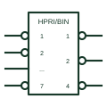

# IEC priority encoder (HPRI/BIN)

IEC coder marked HPRI/BIN that outputs the binary number of the highest-priority active input.

[Canonical reference](https://eloragrid.ai/symbols/iec-priority-encoder) · [Structured record](../entries/iec-priority-encoder.json) · [All references](README.md)

Updated: 2026-10-28. Drawing use: Schematic. Reference families: IEC, Manufacturer.

Graphical convention: IEC. X/Y coder with HPRI/BIN qualifier.

## What it represents

A priority encoder is shown as an X/Y coder with the qualifier HPRI/BIN: highest priority in, binary out. Inputs are numbered by priority, and outputs carry binary weights. Additional outputs often signal that any input is active, which lets stages be cascaded.
On control drawings priority encoders reduce many alarm or request lines to a code, for example to identify the most important active fault for display. The input numbering must match the intended priority order.
The symbol does not state whether inputs are latched. If the encoder input is a momentary event, a latch stage is needed before it.

## How to read it

- Higher input number normally means higher priority.
- Look for group-select or any-active outputs used to cascade.

## Drawing checklist

- Number inputs in priority order.
- Show output weights.
- Show cascade connections.

## Important distinction

A plain binary encoder assumes only one input active; HPRI resolves multiple active inputs.

## Facts

- Qualifier: HPRI/BIN
- Function: Encodes highest-priority active input
- Artwork scope: Original educational illustration; consult the applicable standard and the selected device documentation for the exact graphic

## Public references

- [Overview of IEEE Standard 91-1984: explanation of logic symbols (SDYZ001A)](https://www.ti.com/lit/ml/sdyz001a/sdyz001a.pdf) — Texas Instruments. Coder qualifiers, including code designations.
- [SN74HC148 — priority encoding](https://www.ti.com/lit/ds/symlink/sn74hc148.pdf) — Texas Instruments. Priority encoder documentation.

## Related references

- [Priority encoder](priority-encoder.md)
- [IEC binary decoder (X/Y coder)](iec-binary-decoder.md)
- [IEC general code converter (X/Y)](iec-code-converter.md)

Original educational concept geometry, CC BY 4.0. Unitless; not a certified standards glyph or manufacturer footprint.

Elora-authored explanations are CC BY 4.0. Linked standards and manufacturer material retain their own rights. Confirm project requirements using primary sources.
