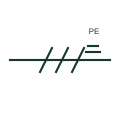

# Protective conductor mark

A mark on one stroke of a conductor group identifying the protective earth conductor carried with the circuit.

[Canonical reference](https://eloragrid.ai/symbols/iec-protective-conductor-mark) · [Structured record](../entries/iec-protective-conductor-mark.json) · [All references](README.md)

Updated: 2026-10-28. Drawing use: SLD, Schematic. Reference families: IEC.

Graphical convention: IEC. Protective conductor identification on a conductor group.

## What it represents

This mark identifies the protective conductor within a group of conductors drawn as one line. It shows that the circuit carries its own PE conductor to the load, which is how the fault return path for automatic disconnection is provided in TN systems. The letters PE are often written beside the mark.
The mark does not tell you whether the PE is a separate core, the cable armour or a parallel earth continuity conductor. Each option affects earth fault loop impedance differently, so the cable schedule must say which is used. The mark is also distinct from the protective earth terminal symbol, which shows a connection point rather than a conductor in a run.

## How to read it

- Confirm what physically forms the PE: a core, armour or separate conductor.
- Check that the PE size meets the protective conductor sizing rule used.

## Drawing checklist

- Mark the PE on every circuit that carries one.
- Identify whether armour is used as the PE.
- Show PE terminations at both ends.

## Important distinction

The PE conductor mark identifies a conductor in a run; the protective earth symbol identifies a connection point to the earthing system.

## Facts

- Graphic cue: Distinct mark on one stroke of a conductor group
- Letter code: PE
- Preview: Original educational illustration; consult the publisher and applicable standard for the exact graphic

## Public references

- [Definition of standardised earthing schemes](https://www.electrical-installation.org/enwiki/Definition_of_standardised_earthing_schemes) — Schneider Electric, Electrical Installation Guide. Public installation-guide definitions of TN, TT and IT schemes and protective conductors.
- [Earthing connections](https://www.electrical-installation.org/enwiki/Earthing_connections) — Schneider Electric, Electrical Installation Guide. Public guide to earthing connection elements.

## Related references

- [Protective earth](protective-earth.md)
- [Neutral conductor mark](iec-neutral-conductor-mark.md)
- [PEN conductor mark](iec-pen-conductor-mark.md)

Original educational concept geometry, CC BY 4.0. Unitless; not a certified standards glyph or manufacturer footprint.

Elora-authored explanations are CC BY 4.0. Linked standards and manufacturer material retain their own rights. Confirm project requirements using primary sources.
