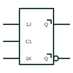

# IEC pulse-triggered (master-slave) JK flip-flop

JK bistable whose outputs carry postponed marks: they change when the clock pulse ends, not at its start.

[Canonical reference](https://eloragrid.ai/symbols/iec-pulse-triggered-jk-flip-flop) · [Structured record](../entries/iec-pulse-triggered-jk-flip-flop.json) · [All references](README.md)

Updated: 2026-10-28. Drawing use: Schematic. Reference families: IEC, Manufacturer.

Graphical convention: IEC. JK bistable with static C1 and postponed-output marks.

## What it represents

A pulse-triggered or master-slave JK flip-flop is drawn with a static C1 input and postponed output marks at Q and its complement. The data must be set up before the clock pulse starts and held while C1 is active; the outputs change when C1 returns to its initial level.
Older TTL designs and some relay-logic equivalents use this behaviour. When reviewing, the presence of the postponed mark tells you that J and K must not change during the clock pulse, a stricter rule than for edge-triggered devices.
If the C1 input also carries a dynamic mark, the device is the data lock-out type, which samples on the edge but still postpones the output.

## How to read it

- Postponed marks at outputs indicate pulse triggering.
- A dynamic C1 together with postponed outputs indicates data lock-out.

## Drawing checklist

- Draw postponed marks next to both outputs.
- Show C1 as static unless data lock-out is intended.
- Note data stability requirements.

## Important distinction

The edge-triggered JK flip-flop has a dynamic C1 and no postponed marks.

## Facts

- Output timing: Changes at end of clock pulse
- Data requirement: Stable for the whole active clock level
- Artwork scope: Original educational illustration; consult the applicable standard and the selected device documentation for the exact graphic

## Public references

- [Overview of IEEE Standard 91-1984: explanation of logic symbols (SDYZ001A)](https://www.ti.com/lit/ml/sdyz001a/sdyz001a.pdf) — Texas Instruments. Pulse-triggered and data lock-out bistable explanations and postponed output qualifier.

## Related references

- [IEC postponed output qualifier](iec-postponed-output.md)
- [IEC JK flip-flop (rectangular form)](iec-jk-flip-flop.md)
- [Negative-edge JK flip-flop](negative-edge-jk-flip-flop.md)

Original educational concept geometry, CC BY 4.0. Unitless; not a certified standards glyph or manufacturer footprint.

Elora-authored explanations are CC BY 4.0. Linked standards and manufacturer material retain their own rights. Confirm project requirements using primary sources.
