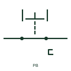

# IEC pushbutton contact: normally closed push button recessed latched

Pushbutton contact form: Normally Closed Push Button Recessed Latched.

[Canonical reference](https://eloragrid.ai/symbols/iec-pushbutton-contact-normally-closed-push-button-recessed-latched) · [Structured record](../entries/iec-pushbutton-contact-normally-closed-push-button-recessed-latched.json) · [All references](README.md)

Updated: 2026-10-28. Drawing use: Schematic. Reference families: IEC, Manufacturer.

Graphical convention: IEC. Normally Closed Push Button Recessed Latched.

## What it represents

A pushbutton translates a person pressing an operator into a change of electrical contact state. The operator form and the contact state are separate pieces of information, so a mushroom head can operate either a normally-open or a normally-closed contact. This entry identifies the normally closed push button recessed latched form in the publisher's IEC-context family.
On a machine control sheet, this form lets the reader distinguish the physical button action from the contact used by the controller. Link every contact block to the same operator tag, including a separate indication lamp when fitted. The normally-closed designation starts with a conducting output or closed contact in the documented reference condition; operation changes that state. The mechanism keeps its operated position until its specified release action; releasing hand pressure alone is insufficient.
The recessed operator is represented as protected by its surrounding profile, which helps distinguish it from a projecting button in the operator schedule. The head shape and contact drawing do not establish a safety category, contact rating or emergency-stop suitability. Direct opening, reset behaviour and the selected assembly must be confirmed from its documentation.

## How to read it

- The normally-closed designation starts with a conducting output or closed contact in the documented reference condition; operation changes that state.
- The mechanism keeps its operated position until its specified release action; releasing hand pressure alone is insufficient.
- The recessed operator is represented as protected by its surrounding profile, which helps distinguish it from a projecting button in the operator schedule.
- The head shape and contact drawing do not establish a safety category, contact rating or emergency-stop suitability. Direct opening, reset behaviour and the selected assembly must be confirmed from its documentation.

## Drawing checklist

- Identify the operator and each associated contact block.
- State the contact state before the operator is pressed.
- Show the release or return action and any independent lamp supply.

## Important distinction

This entry adds the normally closed push button recessed latched detail to the broader pushbutton contact family. The head shape and contact drawing do not establish a safety category, contact rating or emergency-stop suitability. Direct opening, reset behaviour and the selected assembly must be confirmed from its documentation.

## Facts

- Drawing form: Normally Closed Push Button Recessed Latched
- Public vendor block names: HPB12REL / VPB12REL. Autodesk identifiers, not standards database IDs.
- Drawing purpose: pushbutton contact
- Graphic scope: Independently authored educational illustration; not certified standard geometry, a terminal pinout or a product footprint.

## Public references

- [Pushbutton contact and actuator variants](https://help.autodesk.com/cloudhelp/2021/ENU/AutoCAD-Electrical/files/GUID-9E8890C7-7176-47DD-8700-E02A16C1670E.htm) — Autodesk. Public Push Buttons table explicitly lists HPB12REL / VPB12REL with this operating or connection form. Vendor graphics are linked, not copied.

## Related references

- [Normally open pushbutton](pushbutton-no.md)
- [Normally closed pushbutton](pushbutton-nc.md)
- [Emergency-stop operator](emergency-stop.md)

Original educational concept geometry, CC BY 4.0. Unitless; not a certified standards glyph or manufacturer footprint.

Elora-authored explanations are CC BY 4.0. Linked standards and manufacturer material retain their own rights. Confirm project requirements using primary sources.
