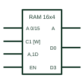

# IEC random-access memory (RAM)

IEC element marked RAM with address grouping, a write control input and A-labelled data inputs and outputs.

[Canonical reference](https://eloragrid.ai/symbols/iec-random-access-memory) · [Structured record](../entries/iec-random-access-memory.json) · [All references](README.md)

Updated: 2026-10-28. Drawing use: Schematic. Reference families: IEC, Manufacturer.

Graphical convention: IEC. Rectangular element with RAM qualifier, address grouping, write control and A-dependent data.

## What it represents

A RAM symbol carries the RAM qualifier and organisation. Address inputs form an A group; a write input is labelled with control dependency, and data inputs are labelled A plus the control number and D, meaning data is written to the addressed word when the control is active. Data outputs are labelled A.
TI's overview builds a 16-word by 4-bit memory from latches to explain this notation. On drawings, RAM symbols document buffers in communication modules and processor boards.
The symbol does not state whether the memory is static or dynamic, its retention behaviour, or any battery backup. Note those where data must survive power loss.

## How to read it

- Write control appears as a C input; data inputs carry A and the control number.
- Check for three-state outputs.

## Drawing checklist

- State the organisation.
- Show write and enable controls with dependency labels.
- Note retention or backup arrangements.

## Important distinction

ROM has no write inputs; FIFO memory has no address inputs.

## Facts

- Qualifier: RAM
- Write notation: A,mD inputs under Cm control
- Artwork scope: Original educational illustration; consult the applicable standard and the selected device documentation for the exact graphic

## Public references

- [Overview of IEEE Standard 91-1984: explanation of logic symbols (SDYZ001A)](https://www.ti.com/lit/ml/sdyz001a/sdyz001a.pdf) — Texas Instruments. RAM qualifier and the memory array example using A dependency.

## Related references

- [IEC read-only memory (ROM)](iec-read-only-memory.md)
- [IEC address dependency (A)](iec-address-dependency-a.md)
- [IEC first-in first-out memory (FIFO)](iec-fifo-memory.md)

Original educational concept geometry, CC BY 4.0. Unitless; not a certified standards glyph or manufacturer footprint.

Elora-authored explanations are CC BY 4.0. Linked standards and manufacturer material retain their own rights. Confirm project requirements using primary sources.
