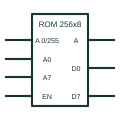

# IEC read-only memory (ROM)

IEC element marked ROM with grouped address inputs and data outputs that read the addressed word.

[Canonical reference](https://eloragrid.ai/symbols/iec-read-only-memory) · [Structured record](../entries/iec-read-only-memory.json) · [All references](README.md)

Updated: 2026-10-28. Drawing use: Schematic. Reference families: IEC, Manufacturer.

Graphical convention: IEC. Rectangular element with ROM qualifier, address grouping and A-dependent outputs.

## What it represents

A ROM is drawn with the ROM qualifier, usually followed by its organisation such as 256x8. Address inputs are grouped with a binary grouping bracket marked A, and data outputs carry an A label to show they deliver the addressed word. Enable inputs often control three-state outputs.
On control drawings ROM symbols document lookup tables, character generators or firmware storage on logic boards. The organisation figure tells a reviewer the address range and data width at a glance.
The symbol does not show the stored content. The content reference, such as a firmware or table file revision, should be noted next to the symbol.

## How to read it

- Organisation such as 256x8 gives words by width.
- Data outputs carry the A label.

## Drawing checklist

- State the organisation.
- Group address inputs with A notation.
- Reference the content revision.

## Important distinction

RAM adds write inputs; ROM outputs only.

## Facts

- Qualifier: ROM
- Notation: A dependency on data outputs
- Artwork scope: Original educational illustration; consult the applicable standard and the selected device documentation for the exact graphic

## Public references

- [Overview of IEEE Standard 91-1984: explanation of logic symbols (SDYZ001A)](https://www.ti.com/lit/ml/sdyz001a/sdyz001a.pdf) — Texas Instruments. Lists ROM and describes A dependency for memories.

## Related references

- [IEC random-access memory (RAM)](iec-random-access-memory.md)
- [IEC address dependency (A)](iec-address-dependency-a.md)
- [IEC first-in first-out memory (FIFO)](iec-fifo-memory.md)

Original educational concept geometry, CC BY 4.0. Unitless; not a certified standards glyph or manufacturer footprint.

Elora-authored explanations are CC BY 4.0. Linked standards and manufacturer material retain their own rights. Confirm project requirements using primary sources.
