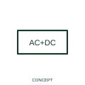

# Rectified-current with AC component qualifier

This qualifier distinguishes rectified current with a remaining alternating component.

[Canonical reference](https://eloragrid.ai/symbols/iec-rectified-current-with-ac-component-qualifier) · [Structured record](../entries/iec-rectified-current-with-ac-component-qualifier.json) · [All references](README.md)

Updated: 2026-10-27. Drawing use: SLD, Schematic. Reference families: IEC, Manufacturer.

Graphical convention: IEC. Rectified-current with AC component qualifier.

## What it represents

This qualifier distinguishes rectified current with a remaining alternating component.
State the converter/source arrangement and relevant waveform information separately.
Rectified output should not automatically be treated as ripple-free DC.

## How to read it

- State the converter/source arrangement and relevant waveform information separately.
- Rectified output should not automatically be treated as ripple-free DC.

## Drawing checklist

- Identify the associated device, circuit or diagram boundary.
- State the converter/source arrangement and relevant waveform information separately.
- Cross-reference the equipment data, terminal mapping or operating-state legend needed to interpret the form.

## Important distinction

Rectified output should not automatically be treated as ripple-free DC.

## Facts

- Reference scope: Specific public IEC-context family form
- Publisher reference token: Q020212 (Autodesk token; not a verified IEC database ID)
- Information added: State the converter/source arrangement and relevant waveform information separately.
- Preview: Independent educational concept; consult the publisher and applicable standard for the exact graphic

## Public references

- [AutoCAD Electrical: Winding arrangements and AC/DC indications](https://help.autodesk.com/cloudhelp/2021/ENU/AutoCAD-Electrical/files/GUID-3F5A759D-872A-4990-8AAE-7CCAFBBBD4C5.htm) — Autodesk. Official public publisher family name and reference context; vendor identifiers and graphics are distinct from licensed IEC database content.

## Related references

- [Three-phase motor](motor.md)
- [Generator](generator.md)

Original educational concept geometry, CC BY 4.0. Unitless; not a certified standards glyph or manufacturer footprint.

Elora-authored explanations are CC BY 4.0. Linked standards and manufacturer material retain their own rights. Confirm project requirements using primary sources.
