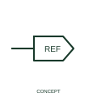

# Reference-only wire arrow

A reference-only arrow directs the reader to an associated wire continuation or annotation.

[Canonical reference](https://eloragrid.ai/symbols/iec-reference-only-wire-arrow) · [Structured record](../entries/iec-reference-only-wire-arrow.json) · [All references](README.md)

Updated: 2026-10-27. Drawing use: Schematic. Reference families: Manufacturer.

## What it represents

A reference-only arrow directs the reader to an associated wire continuation or annotation.
Distinguish the graphic's reference role from any software-managed signal link.
Changing the arrow orientation does not change the underlying engineering meaning.

## How to read it

- Distinguish the graphic's reference role from any software-managed signal link.
- Changing the arrow orientation does not change the underlying engineering meaning.

## Drawing checklist

- Identify the associated device, circuit or diagram boundary.
- Distinguish the graphic's reference role from any software-managed signal link.
- Cross-reference the equipment data, terminal mapping or operating-state legend needed to interpret the form.

## Important distinction

Changing the arrow orientation does not change the underlying engineering meaning.

## Facts

- Reference scope: Publisher drafting annotation / connectivity convention
- Publisher reference token: HA1X1, HA1X1Y (Autodesk token; not a verified IEC database ID)
- Information added: Distinguish the graphic's reference role from any software-managed signal link.
- Preview: Independent educational concept; consult the publisher and applicable standard for the exact graphic

## Public references

- [Autodesk IEC-60617 preview: Reference-only wire arrows](https://help.autodesk.com/cloudhelp/2021/ENU/AutoCAD-Electrical/files/GUID-B63E664D-D5DC-4FA9-ACAE-6D9217550C33.htm) — Autodesk. Official public publisher family name and reference context; vendor identifiers and graphics are distinct from licensed IEC database content.

## Related references

- [Terminal connection](terminal.md)
- [Busbar](busbar.md)

Original educational concept geometry, CC BY 4.0. Unitless; not a certified standards glyph or manufacturer footprint.

Elora-authored explanations are CC BY 4.0. Linked standards and manufacturer material retain their own rights. Confirm project requirements using primary sources.
