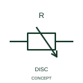

# Resistor with disconnecting slider

This form distinguishes a movable resistor contact with a disconnecting position.

[Canonical reference](https://eloragrid.ai/symbols/iec-resistor-with-disconnecting-slider) · [Structured record](../entries/iec-resistor-with-disconnecting-slider.json) · [All references](README.md)

Updated: 2026-10-27. Drawing use: Schematic. Reference families: IEC, Manufacturer.

Graphical convention: IEC. Resistor with disconnecting slider.

## What it represents

This form distinguishes a movable resistor contact with a disconnecting position. The movable contact can leave the resistive track at its documented disconnecting position. This changes circuit continuity as well as the selected resistance.
Show the track ends, slider terminal and the off-position relationship. A generic potentiometer or variable-resistor graphic can omit this important additional operating state.

## How to read it

- Show the track terminals, movable contact and the circuit condition at the off position.
- A disconnecting slider is different from a continuously connected potentiometer wiper.

## Drawing checklist

- Identify the associated device, circuit or diagram boundary.
- Show the track terminals, movable contact and the circuit condition at the off position.
- Cross-reference the equipment data, terminal mapping or operating-state legend needed to interpret the form.

## Important distinction

A disconnecting slider is different from a continuously connected potentiometer wiper.

## Facts

- Reference scope: Specific public IEC-context family form
- Publisher reference token: HVR1R5 (Autodesk token; not a verified IEC database ID)
- Information added: Show the track terminals, movable contact and the circuit condition at the off position.
- Preview: Independent educational concept; consult the publisher and applicable standard for the exact graphic

## Public references

- [Resistors and heater-element symbols](https://help.autodesk.com/cloudhelp/2021/ENU/AutoCAD-Electrical/files/GUID-1D071951-D38E-4B15-8B9E-C30ECBD55C19.htm) — Autodesk. Official public publisher family name and reference context; vendor identifiers and graphics are distinct from licensed IEC database content.

## Related references

- [Resistor](resistor.md)
- [Capacitor](capacitor.md)

Original educational concept geometry, CC BY 4.0. Unitless; not a certified standards glyph or manufacturer footprint.

Elora-authored explanations are CC BY 4.0. Linked standards and manufacturer material retain their own rights. Confirm project requirements using primary sources.
