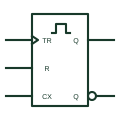

# IEC retriggerable monostable

IEC monostable showing only the single-pulse qualifier; each new trigger restarts the output pulse.

[Canonical reference](https://eloragrid.ai/symbols/iec-retriggerable-monostable) · [Structured record](../entries/iec-retriggerable-monostable.json) · [All references](README.md)

Updated: 2026-10-28. Drawing use: Schematic. Reference families: IEC, Manufacturer.

Graphical convention: IEC. Rectangular element with the single-pulse qualifier only.

## What it represents

The retriggerable monostable is marked with the single pulse shape without the preceding 1. Each trigger during the output pulse restarts the timing, so the output remains active as long as triggers arrive more often than the set period.
This behaviour is useful for missing-pulse detection and activity monitoring, where the output drops only when a regular signal stops. The drawing should note the expected trigger rate and the timeout chosen.
The symbol does not show whether a clear input truncates the pulse. Check for an R input and its polarity. Include reset behaviour in the timing chart so a missing-pulse indication can be distinguished from an externally forced clear.

## How to read it

- Each trigger restarts the pulse.
- Look for a clear or reset input.

## Drawing checklist

- Show the single-pulse qualifier without the 1.
- Draw timing components and state the timeout.
- State the expected trigger rate.

## Important distinction

The non-retriggerable form has the 1 qualifier and ignores triggers during the pulse.

## Facts

- Retrigger behaviour: Restarts timing
- Typical use: Missing-pulse detection
- Artwork scope: Original educational illustration; consult the applicable standard and the selected device documentation for the exact graphic

## Public references

- [Overview of IEEE Standard 91-1984: explanation of logic symbols (SDYZ001A)](https://www.ti.com/lit/ml/sdyz001a/sdyz001a.pdf) — Texas Instruments. Lists the retriggerable monostable general qualifier.
- [CD74HC123 — retriggerable monostables](https://www.ti.com/product/CD74HC123) — Texas Instruments. Retriggerable monostable device documentation.

## Related references

- [Retriggerable monostable](retriggerable-monostable.md)
- [IEC non-retriggerable monostable](iec-non-retriggerable-monostable.md)
- [Watchdog timer](watchdog-timer.md)

Original educational concept geometry, CC BY 4.0. Unitless; not a certified standards glyph or manufacturer footprint.

Elora-authored explanations are CC BY 4.0. Linked standards and manufacturer material retain their own rights. Confirm project requirements using primary sources.
