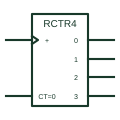

# IEC ripple counter (RCTRm)

IEC counter marked RCTRm: an asynchronous ripple-carry counter with a cycle length of 2 to the power m.

[Canonical reference](https://eloragrid.ai/symbols/iec-ripple-counter) · [Structured record](../entries/iec-ripple-counter.json) · [All references](README.md)

Updated: 2026-10-28. Drawing use: Schematic. Reference families: IEC, Manufacturer.

Graphical convention: IEC. Rectangular element with the RCTRm qualifier.

## What it represents

RCTRm identifies an asynchronous or ripple-carry counter of m bits. Each stage clocks the next, so outputs change one after another rather than simultaneously. The clock input carries a dynamic mark, and a clear input is usually shown as an asynchronous R.
Ripple counters are used where outputs are not decoded together at high speed, such as long frequency dividers or simple timers. Drawing them with RCTR rather than CTR warns a reviewer that decoding several outputs together may produce brief false states.
The symbol does not state the cumulative delay through the stages. That depends on the logic family and the number of bits.

## How to read it

- RCTR warns that outputs settle in sequence.
- Avoid decoding multiple outputs without synchronisation.

## Drawing checklist

- Use RCTR for asynchronous counters.
- Show the clear input and its polarity.
- Note any decoding that relies on stable outputs.

## Important distinction

CTRm counters are synchronous and all outputs change on the same clock edge.

## Facts

- Qualifier: RCTRm
- Timing: Outputs change in sequence
- Artwork scope: Original educational illustration; consult the applicable standard and the selected device documentation for the exact graphic

## Public references

- [Overview of IEEE Standard 91-1984: explanation of logic symbols (SDYZ001A)](https://www.ti.com/lit/ml/sdyz001a/sdyz001a.pdf) — Texas Instruments. Lists RCTRm as the asynchronous ripple-carry counter qualifier.
- [SN74HC393 — ripple binary counters](https://www.ti.com/lit/ds/symlink/sn74hc393.pdf) — Texas Instruments. Ripple binary counter documentation.

## Related references

- [Ripple binary counter](ripple-binary-counter.md)
- [IEC synchronous binary counter (CTRm)](iec-synchronous-binary-counter.md)
- [IEC T (toggle) flip-flop](iec-t-flip-flop.md)

Original educational concept geometry, CC BY 4.0. Unitless; not a certified standards glyph or manufacturer footprint.

Elora-authored explanations are CC BY 4.0. Linked standards and manufacturer material retain their own rights. Confirm project requirements using primary sources.
