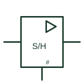

# IEC sample-and-hold element

Analogue element marked S/H with a digital control input; it tracks the input, then holds the last value.

[Canonical reference](https://eloragrid.ai/symbols/iec-sample-and-hold) · [Structured record](../entries/iec-sample-and-hold.json) · [All references](README.md)

Updated: 2026-10-28. Drawing use: Schematic. Reference families: IEC, Manufacturer.

Graphical convention: IEC. Rectangular analogue element with S/H function and a digital control input.

## What it represents

The sample-and-hold element has an analogue input, an analogue output and a digital control input. While the control is in the sample state the output follows the input; when it changes to hold, the output keeps the last value. IEC-style analogue diagrams mark the digital control input with a # sign, as TI's overview describes for digital inputs on analogue symbols.
Sample-and-hold stages appear in front of analogue-to-digital converters, in multiplexed measurement systems and in peak capture. The drawing should show the control signal source and the hold capacitor, because the hold quality depends on it.
The element does not show droop rate, acquisition time or aperture delay. Those are device and component properties. Check the acquisition interval and hold duration against the measurement sequence and the selected component data.

## How to read it

- Identify the digital control input and its sense.
- Find the hold capacitor.

## Drawing checklist

- Mark the control input as digital.
- Show the hold capacitor value.
- State acquisition and hold timing where critical.

## Important distinction

An analogue switch alone passes signals; the S/H element includes the hold storage and buffering.

## Facts

- Inputs: Analogue signal plus digital control
- Key parameters: Acquisition time, droop
- Artwork scope: Original educational illustration; consult the applicable standard and the selected device documentation for the exact graphic

## Public references

- [Overview of IEEE Standard 91-1984: explanation of logic symbols (SDYZ001A)](https://www.ti.com/lit/ml/sdyz001a/sdyz001a.pdf) — Texas Instruments. Describes # as the marking for digital inputs on analogue symbols.
- [AN-1515: sample-and-hold function using an analogue switch](https://www.analog.com/en/resources/app-notes/an-1515.html) — Analog Devices. Manufacturer sample-and-hold application note.

## Related references

- [Sample-and-hold amplifier](sample-and-hold-amplifier.md)
- [Analogue-to-digital converter](analog-to-digital-converter.md)
- [Analogue bilateral switch](analog-bilateral-switch.md)

Original educational concept geometry, CC BY 4.0. Unitless; not a certified standards glyph or manufacturer footprint.

Elora-authored explanations are CC BY 4.0. Linked standards and manufacturer material retain their own rights. Confirm project requirements using primary sources.
