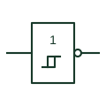

# IEC Schmitt-trigger inverter (rectangular form)

IEC inverter with the hysteresis mark, used to clean up slow edges while inverting the signal.

[Canonical reference](https://eloragrid.ai/symbols/iec-schmitt-trigger-inverter) · [Structured record](../entries/iec-schmitt-trigger-inverter.json) · [All references](README.md)

Updated: 2026-10-28. Drawing use: Schematic. Reference families: IEC, Manufacturer.

Graphical convention: IEC. 1 element with hysteresis qualifier and output negation.

## What it represents

This element combines the 1 qualifier, the hysteresis mark and output negation. It inverts the signal while switching at two thresholds, which makes it a common choice for debouncing contacts with an RC network and for building simple relaxation oscillators.
When a Schmitt inverter forms part of an oscillator or delay with external resistors and capacitors, the drawing should keep those components next to the element and note the intended timing. The symbol alone gives no clue that it is part of a timing circuit.
Thresholds, hysteresis width and supply range are device data. Different logic families have markedly different thresholds even though the symbol is identical.

## How to read it

- Check for external RC parts that turn the inverter into a timing circuit.
- Confirm the output negation as well as the hysteresis mark.

## Drawing checklist

- Show both the hysteresis mark and the output negation.
- Keep associated RC components adjacent.
- Note the intended timing if used as an oscillator or debounce.

## Important distinction

The Schmitt buffer has the same hysteresis mark but no output negation.

## Facts

- Qualifier: 1, hysteresis mark, output negation
- Common circuits: Contact debounce, RC oscillator
- Artwork scope: Original educational illustration; consult the applicable standard and the selected device documentation for the exact graphic

## Public references

- [Overview of IEEE Standard 91-1984: explanation of logic symbols (SDYZ001A)](https://www.ti.com/lit/ml/sdyz001a/sdyz001a.pdf) — Texas Instruments. Hysteresis and negation qualifiers.
- [SN74HC14 — Schmitt-trigger inverters](https://www.ti.com/lit/ds/symlink/sn74hc14.pdf) — Texas Instruments. Manufacturer Schmitt-trigger inverter documentation.

## Related references

- [Schmitt-trigger inverter](schmitt-trigger-inverter.md)
- [IEC Schmitt-trigger buffer (rectangular form)](iec-schmitt-trigger-buffer.md)
- [IEC NOT element (rectangular form)](iec-not-gate.md)

Original educational concept geometry, CC BY 4.0. Unitless; not a certified standards glyph or manufacturer footprint.

Elora-authored explanations are CC BY 4.0. Linked standards and manufacturer material retain their own rights. Confirm project requirements using primary sources.
