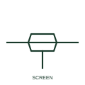

# Screened conductor

A single conductor enclosed by a drawn screen outline, showing that the core has a conductive shield around it.

[Canonical reference](https://eloragrid.ai/symbols/iec-screened-conductor) · [Structured record](../entries/iec-screened-conductor.json) · [All references](README.md)

Updated: 2026-10-28. Drawing use: Schematic. Reference families: IEC.

Graphical convention: IEC. Screened single-conductor form.

## What it represents

A screened conductor symbol adds an outline around one conductor to show a conductive screen, braid or foil surrounding the core. It is used for analogue instrument signals, encoder and thermocouple extension wiring and other circuits where capacitively coupled interference must be kept off the signal.
The outline alone does not show where or whether the screen is earthed. Earthing at one end, both ends or through a capacitor is a design decision that should be drawn explicitly with an earth or bonding symbol at the screen tail. The symbol also does not distinguish foil, braid or combined screens, which belong in the cable schedule.

## How to read it

- Find the screen tail and confirm where it is terminated.
- Check whether a cable marker applies to the screened core and any others in the same cable.

## Drawing checklist

- Show the screen termination point explicitly.
- Record the screen type in the cable schedule.
- Keep screen drain terminals numbered on the terminal plan.

## Important distinction

A screened conductor has a conductive shield; a cable-core grouping outline only shows that several cores share one sheath and implies no shielding.

## Facts

- Graphic cue: Outline drawn around a single conductor with a short screen tail
- Does not show: Screen earthing point, screen material or coverage
- Preview: Original educational illustration; consult the publisher and applicable standard for the exact graphic

## Public references

- [Autodesk IEC-60617 preview: Cable identification and twisted-pair annotation](https://help.autodesk.com/cloudhelp/2021/ENU/AutoCAD-Electrical/files/GUID-37A08C35-43A3-484D-B0EB-0BBCBC4BE709.htm) — Autodesk. Public IEC-60617 preview family for cable annotation used alongside screened-core forms.
- [IEC-60617 symbol preview directory](https://help.autodesk.com/cloudhelp/2021/ENU/AutoCAD-Electrical/files/GUID-7871E6EF-24D5-467E-9B74-321FEDC9DFDA.htm) — Autodesk. Public directory of IEC-oriented symbol families.

## Related references

- [Screened conductor with earthed screen](iec-screened-conductor-with-earthed-screen.md)
- [Screened multi-conductor cable](iec-screened-multi-conductor-cable.md)
- [Functional earth](functional-earth.md)

Original educational concept geometry, CC BY 4.0. Unitless; not a certified standards glyph or manufacturer footprint.

Elora-authored explanations are CC BY 4.0. Linked standards and manufacturer material retain their own rights. Confirm project requirements using primary sources.
