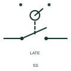

# IEC selector-switch contact: normally open delayed contact

Selector-switch contact form: Normally Open Delayed Contact.

[Canonical reference](https://eloragrid.ai/symbols/iec-selector-switch-contact-normally-open-delayed-contact) · [Structured record](../entries/iec-selector-switch-contact-normally-open-delayed-contact.json) · [All references](README.md)

Updated: 2026-10-28. Drawing use: Schematic. Reference families: IEC, Manufacturer.

Graphical convention: IEC. Normally Open Delayed Contact.

## What it represents

A rotary selector has discrete handle positions and one or more contact blocks driven by its mechanism. A contact shown as normally open or normally closed describes the stated reference position; it does not give the whole switching table across the remaining positions. This entry identifies the normally open delayed contact form in the publisher's IEC-context family.
For a local/off/remote selector, prepare a contact-versus-position chart alongside the schematic. The chart tells the installer which input is active at each handle setting, while spring-return, maintained and key-operated marks explain how the operator reaches or leaves that setting. The normally-open designation starts with a non-conducting output or open contact in the documented reference condition; operation changes that state. The late contact changes after the associated ordinary contacts during the stated mechanism movement; this is contact sequencing rather than an independently adjustable time delay.
A vendor neutral-position number must be read with that vendor form and the project legend. It does not automatically establish a key-removal position, a contact overlap or an off state. Those details need their own table or equipment reference.

## How to read it

- The normally-open designation starts with a non-conducting output or open contact in the documented reference condition; operation changes that state.
- The late contact changes after the associated ordinary contacts during the stated mechanism movement; this is contact sequencing rather than an independently adjustable time delay.
- A vendor neutral-position number must be read with that vendor form and the project legend. It does not automatically establish a key-removal position, a contact overlap or an off state. Those details need their own table or equipment reference.

## Drawing checklist

- Label every handle position and preserve its reference orientation.
- Cross-reference a contact-versus-position chart.
- State maintained positions, return directions and any key-removal conditions.

## Important distinction

This entry adds the normally open delayed contact detail to the broader selector-switch contact family. A vendor neutral-position number must be read with that vendor form and the project legend. It does not automatically establish a key-removal position, a contact overlap or an off state. Those details need their own table or equipment reference.

## Facts

- Drawing form: Normally Open Delayed Contact
- Public vendor block names: HSS218F / VSS218F. Autodesk identifiers, not standards database IDs.
- Drawing purpose: selector-switch contact
- Graphic scope: Independently authored educational illustration; not certified standard geometry, a terminal pinout or a product footprint.

## Public references

- [Selector-switch contact and operating variants](https://help.autodesk.com/cloudhelp/2021/ENU/AutoCAD-Electrical/files/GUID-E1B4D1DE-C709-4E3E-AF7C-1A8989D096E9.htm) — Autodesk. Public Selector Switches table explicitly lists HSS218F / VSS218F with this operating or connection form. Vendor graphics are linked, not copied.

## Related references

- [Selector switch](selector-switch.md)
- [Three-position maintained selector](three-position-maintained-selector.md)
- [Three-position centre-return selector](three-position-centre-return-selector.md)

Original educational concept geometry, CC BY 4.0. Unitless; not a certified standards glyph or manufacturer footprint.

Elora-authored explanations are CC BY 4.0. Linked standards and manufacturer material retain their own rights. Confirm project requirements using primary sources.
