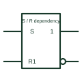

# IEC set and reset dependency (S, R)

Dependency labels Sm and Rm: the affected output behaves as if set or reset when the affecting input is active.

[Canonical reference](https://eloragrid.ai/symbols/iec-set-reset-dependency) · [Structured record](../entries/iec-set-reset-dependency.json) · [All references](README.md)

Updated: 2026-10-28. Drawing use: Schematic. Reference families: IEC, Manufacturer.

Graphical convention: IEC. Affecting inputs labelled Sm or Rm with affected outputs labelled m.

## What it represents

S and R dependencies specify the internal state of an output when both set and reset conditions could be active together. An Rm input at its internal 1 state makes the affected output react as it would to S=0, R=1; an Sm input does the opposite. At 0 they have no effect.
These labels are used where a storage element must have a defined priority between set and reset. A reader can see from the symbol whether set or reset dominates, which matters in latching alarm and interlock logic.
Plain S and R labels without numbers are the ordinary set and reset inputs of a bistable element. The dependency form only applies when a number follows the letter.

## How to read it

- S or R followed by a number is a dependency; without a number it is an ordinary input.
- Check which one dominates when both are active.

## Drawing checklist

- Number dependency inputs explicitly.
- Label affected outputs with the matching number.
- State set or reset priority in the logic description.

## Important distinction

An ordinary R input resets the element directly; Rm dependency states the reaction of particular outputs.

## Facts

- Rm at 1: Output reacts as to S=0, R=1
- Sm at 1: Output reacts as to S=1, R=0
- Artwork scope: Original educational illustration; consult the applicable standard and the selected device documentation for the exact graphic

## Public references

- [Overview of IEEE Standard 91-1984: explanation of logic symbols (SDYZ001A)](https://www.ti.com/lit/ml/sdyz001a/sdyz001a.pdf) — Texas Instruments. S (set) and R (reset) dependencies and the summary table.

## Related references

- [IEC SR latch (rectangular form)](iec-sr-latch.md)
- [Set-reset latch](set-reset-latch.md)
- [IEC clocked SR flip-flop](iec-clocked-sr-flip-flop.md)

Original educational concept geometry, CC BY 4.0. Unitless; not a certified standards glyph or manufacturer footprint.

Elora-authored explanations are CC BY 4.0. Linked standards and manufacturer material retain their own rights. Confirm project requirements using primary sources.
