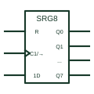

# IEC shift register (SRGm)

IEC register marked SRGm with m stages; the clock carries the shift arrow and moves data one place each cycle.

[Canonical reference](https://eloragrid.ai/symbols/iec-shift-register) · [Structured record](../entries/iec-shift-register.json) · [All references](README.md)

Updated: 2026-10-28. Drawing use: Schematic. Reference families: IEC, Manufacturer.

Graphical convention: IEC. Rectangular element with SRGm qualifier and a shift-right clock.

## What it represents

SRGm identifies a shift register of m bits. The clock input is labelled with C1 and a shift arrow, showing that each active edge moves data one place. The serial input is labelled 1D, and the parallel outputs are listed down the right side, typically in a column of per-bit elements under a common-control block.
On drawings, shift registers expand outputs for indicators or relay drivers, or capture serial data from a sensor. The reader should identify the shift direction, the serial input, and any output latch or enable, as these decide how and when outputs update.
The symbol does not show the data rate or the serial protocol. Those come from the controller documentation driving the register.

## How to read it

- Identify the shift direction from the arrow.
- Check for an output latch that holds outputs during shifting.

## Drawing checklist

- State the bit count in the qualifier.
- Label the serial input as 1D.
- Show the output latch and enable if present.

## Important distinction

A latched shift register adds a storage register and its own clock between the shift stages and the outputs.

## Facts

- Qualifier: SRGm
- Clock label: C1 with shift arrow
- Artwork scope: Original educational illustration; consult the applicable standard and the selected device documentation for the exact graphic

## Public references

- [Overview of IEEE Standard 91-1984: explanation of logic symbols (SDYZ001A)](https://www.ti.com/lit/ml/sdyz001a/sdyz001a.pdf) — Texas Instruments. Lists SRGm and shift right or left input labels.
- [SN74HC164 — serial-in parallel-out shift storage](https://www.ti.com/lit/ds/symlink/sn74hc164.pdf) — Texas Instruments. Serial-in parallel-out shift register documentation.

## Related references

- [Serial-in parallel-out register](serial-in-parallel-out-register.md)
- [Shift register with output latch](latched-shift-register.md)
- [IEC bidirectional (universal) shift register](iec-bidirectional-shift-register.md)

Original educational concept geometry, CC BY 4.0. Unitless; not a certified standards glyph or manufacturer footprint.

Elora-authored explanations are CC BY 4.0. Linked standards and manufacturer material retain their own rights. Confirm project requirements using primary sources.
