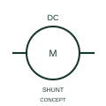

# Shunt-excited DC motor

This representation distinguishes the publisher's derived or shunt-excitation DC motor form.

[Canonical reference](https://eloragrid.ai/symbols/iec-shunt-excited-dc-motor) · [Structured record](../entries/iec-shunt-excited-dc-motor.json) · [All references](README.md)

Updated: 2026-10-27. Drawing use: SLD, Schematic. Reference families: IEC, Manufacturer.

Graphical convention: IEC. Shunt-excited DC motor.

## What it represents

This representation distinguishes the publisher's derived or shunt-excitation DC motor form.
Document the field connection separately from the armature circuit.
Shunt, series and separately supplied field arrangements are different connection topologies.

## How to read it

- Document the field connection separately from the armature circuit.
- Shunt, series and separately supplied field arrangements are different connection topologies.

## Drawing checklist

- Identify the associated device, circuit or diagram boundary.
- Document the field connection separately from the armature circuit.
- Cross-reference the equipment data, terminal mapping or operating-state legend needed to interpret the form.

## Important distinction

Shunt, series and separately supplied field arrangements are different connection topologies.

## Facts

- Reference scope: Specific public IEC-context family form
- Publisher reference token: HMO1M8 (Autodesk token; not a verified IEC database ID)
- Information added: Document the field connection separately from the armature circuit.
- Preview: Independent educational concept; consult the publisher and applicable standard for the exact graphic

## Public references

- [AutoCAD Electrical: DC motors](https://help.autodesk.com/cloudhelp/2021/ENU/AutoCAD-Electrical/files/GUID-F5F3061F-E0DE-4A9A-BE88-C017545A9A36.htm) — Autodesk. Official public publisher family name and reference context; vendor identifiers and graphics are distinct from licensed IEC database content.

## Related references

- [Three-phase motor](motor.md)
- [Generator](generator.md)

Original educational concept geometry, CC BY 4.0. Unitless; not a certified standards glyph or manufacturer footprint.

Elora-authored explanations are CC BY 4.0. Linked standards and manufacturer material retain their own rights. Confirm project requirements using primary sources.
