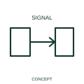

# Signal-reception qualifier

A reception qualifier identifies the receiving role of a signal interface.

[Canonical reference](https://eloragrid.ai/symbols/iec-signal-reception-qualifier) · [Structured record](../entries/iec-signal-reception-qualifier.json) · [All references](README.md)

Updated: 2026-10-27. Drawing use: Schematic. Reference families: IEC, Manufacturer.

Graphical convention: IEC. Signal-reception qualifier.

## What it represents

A reception qualifier identifies the receiving role of a signal interface. Reception identifies the destination role of the represented signal relationship. It does not describe how the receiver is powered or what subsequent control action occurs.
Label the received signal and its source. Where one receiver participates in several control functions, use circuit references to connect the shared input to those functions.

## How to read it

- Label the incoming signal and the supplying transmitter or source.
- Receiving a signal is distinct from supplying electrical power to the interface.

## Drawing checklist

- Identify the associated device, circuit or diagram boundary.
- Label the incoming signal and the supplying transmitter or source.
- Cross-reference the equipment data, terminal mapping or operating-state legend needed to interpret the form.

## Important distinction

Receiving a signal is distinct from supplying electrical power to the interface.

## Facts

- Reference scope: Specific public IEC-context family form
- Publisher reference token: Q020505 (Autodesk token; not a verified IEC database ID)
- Information added: Label the incoming signal and the supplying transmitter or source.
- Preview: Independent educational concept; consult the publisher and applicable standard for the exact graphic

## Public references

- [Autodesk IEC-60617 preview: Propagation and signal-flow qualifiers](https://help.autodesk.com/cloudhelp/2021/ENU/AutoCAD-Electrical/files/GUID-1C0C7AE2-F703-4283-BCB1-3E0B30882715.htm) — Autodesk. Official public publisher family name and reference context; vendor identifiers and graphics are distinct from licensed IEC database content.

## Related references

- [Power converter / inverter](power-converter.md)
- [PLC input / output](plc-io.md)

Original educational concept geometry, CC BY 4.0. Unitless; not a certified standards glyph or manufacturer footprint.

Elora-authored explanations are CC BY 4.0. Linked standards and manufacturer material retain their own rights. Confirm project requirements using primary sources.
