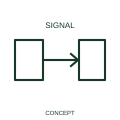

# Signal-transmission qualifier

A transmission qualifier identifies the sending role of a signal interface.

[Canonical reference](https://eloragrid.ai/symbols/iec-signal-transmission-qualifier) · [Structured record](../entries/iec-signal-transmission-qualifier.json) · [All references](README.md)

Updated: 2026-10-27. Drawing use: Schematic. Reference families: IEC, Manufacturer.

Graphical convention: IEC. Signal-transmission qualifier.

## What it represents

A transmission qualifier identifies the sending role of a signal interface. Transmission identifies the source role of a signal relationship. It can be used beside a transducer, communications interface or other function whose output is conveyed elsewhere.
Identify the receiving function through a tag or cross-reference. Signal units and electrical interface details belong in the associated I/O or communications schedule.

## How to read it

- Label the signal and the connected receiving function.
- A transmitter-role indication does not identify the physical medium or electrical levels.

## Drawing checklist

- Identify the associated device, circuit or diagram boundary.
- Label the signal and the connected receiving function.
- Cross-reference the equipment data, terminal mapping or operating-state legend needed to interpret the form.

## Important distinction

A transmitter-role indication does not identify the physical medium or electrical levels.

## Facts

- Reference scope: Specific public IEC-context family form
- Publisher reference token: Q020504 (Autodesk token; not a verified IEC database ID)
- Information added: Label the signal and the connected receiving function.
- Preview: Independent educational concept; consult the publisher and applicable standard for the exact graphic

## Public references

- [Autodesk IEC-60617 preview: Propagation and signal-flow qualifiers](https://help.autodesk.com/cloudhelp/2021/ENU/AutoCAD-Electrical/files/GUID-1C0C7AE2-F703-4283-BCB1-3E0B30882715.htm) — Autodesk. Official public publisher family name and reference context; vendor identifiers and graphics are distinct from licensed IEC database content.

## Related references

- [Power converter / inverter](power-converter.md)
- [PLC input / output](plc-io.md)

Original educational concept geometry, CC BY 4.0. Unitless; not a certified standards glyph or manufacturer footprint.

Elora-authored explanations are CC BY 4.0. Linked standards and manufacturer material retain their own rights. Confirm project requirements using primary sources.
