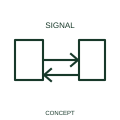

# Simultaneous bidirectional propagation qualifier

This qualifier distinguishes a path supporting propagation in both directions at the same time.

[Canonical reference](https://eloragrid.ai/symbols/iec-simultaneous-bidirectional-propagation-qualifier) · [Structured record](../entries/iec-simultaneous-bidirectional-propagation-qualifier.json) · [All references](README.md)

Updated: 2026-10-27. Drawing use: Schematic. Reference families: IEC, Manufacturer.

Graphical convention: IEC. Simultaneous bidirectional propagation qualifier.

## What it represents

This qualifier distinguishes a path supporting propagation in both directions at the same time. The represented interface supports sending and receiving in opposite directions simultaneously. That operating relationship is separate from the physical media and protocol.
A communications drawing should identify each endpoint and the actual interface. The qualifier supplies a direction relationship without declaring a network implementation.

## How to read it

- State the interface and communication arrangement represented.
- A bidirectional graphic does not specify a communication protocol or throughput.

## Drawing checklist

- Identify the associated device, circuit or diagram boundary.
- State the interface and communication arrangement represented.
- Cross-reference the equipment data, terminal mapping or operating-state legend needed to interpret the form.

## Important distinction

A bidirectional graphic does not specify a communication protocol or throughput.

## Facts

- Reference scope: Specific public IEC-context family form
- Publisher reference token: Q020502 (Autodesk token; not a verified IEC database ID)
- Information added: State the interface and communication arrangement represented.
- Preview: Independent educational concept; consult the publisher and applicable standard for the exact graphic

## Public references

- [Autodesk IEC-60617 preview: Propagation and signal-flow qualifiers](https://help.autodesk.com/cloudhelp/2021/ENU/AutoCAD-Electrical/files/GUID-1C0C7AE2-F703-4283-BCB1-3E0B30882715.htm) — Autodesk. Official public publisher family name and reference context; vendor identifiers and graphics are distinct from licensed IEC database content.

## Related references

- [Power converter / inverter](power-converter.md)
- [PLC input / output](plc-io.md)

Original educational concept geometry, CC BY 4.0. Unitless; not a certified standards glyph or manufacturer footprint.

Elora-authored explanations are CC BY 4.0. Linked standards and manufacturer material retain their own rights. Confirm project requirements using primary sources.
