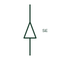

# Single-core cable sealing end

The termination at the end of a single-core cable where it is sealed and connected to an overhead line or equipment.

[Canonical reference](https://eloragrid.ai/symbols/iec-single-core-cable-sealing-end) · [Structured record](../entries/iec-single-core-cable-sealing-end.json) · [All references](README.md)

Updated: 2026-10-28. Drawing use: SLD, Schematic. Reference families: IEC.

Graphical convention: IEC. Single-core sealing end.

## What it represents

A sealing end terminates a cable by controlling the electric stress at the screen cut-back, sealing out moisture and providing a connection to the conductor. The single-core form appears at each phase of medium and high voltage single-core cable circuits, typically at the cable to overhead line transition or at outdoor switchyard equipment.
The symbol does not show whether the termination is indoor or outdoor, heat-shrink, cold-shrink or porcelain, nor how the cable screen is bonded. Screen bonding at sealing ends, for example solid bonding or single-point bonding with sheath voltage limiters, must be drawn separately.

## How to read it

- Check the screen bonding arrangement at each sealing end.
- Look for surge arresters fitted beside outdoor sealing ends.

## Drawing checklist

- State termination type and voltage class.
- Show screen bonding at the termination.
- Identify the equipment or line the sealing end connects to.

## Important distinction

A sealing end terminates a cable; a straight-through joint connects two cable lengths together.

## Facts

- Graphic cue: Triangular or cone-shaped termination at the cable end
- Does not show: Indoor or outdoor type and screen bonding
- Preview: Original educational illustration; consult the publisher and applicable standard for the exact graphic

## Public references

- [Elastimold underground cable accessories](https://www.abb.com/global/en/areas/electrification/medium-voltage/cable-accessories-connectors/underground/elastimold/underground) — ABB. Manufacturer context for cable terminations and accessories.
- [IEC-60617 symbol preview directory](https://help.autodesk.com/cloudhelp/2021/ENU/AutoCAD-Electrical/files/GUID-7871E6EF-24D5-467E-9B74-321FEDC9DFDA.htm) — Autodesk. Public directory of IEC-oriented symbol families.

## Related references

- [Multicore cable sealing end](iec-multicore-cable-sealing-end.md)
- [Overhead line](iec-overhead-line.md)
- [Cable termination compartment](ga-cable-termination-compartment.md)

Original educational concept geometry, CC BY 4.0. Unitless; not a certified standards glyph or manufacturer footprint.

Elora-authored explanations are CC BY 4.0. Linked standards and manufacturer material retain their own rights. Confirm project requirements using primary sources.
