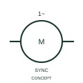

# Single-phase synchronous motor

This representation identifies a single-phase synchronous machine function.

[Canonical reference](https://eloragrid.ai/symbols/iec-single-phase-synchronous-motor) · [Structured record](../entries/iec-single-phase-synchronous-motor.json) · [All references](README.md)

Updated: 2026-10-27. Drawing use: SLD, Schematic. Reference families: IEC, Manufacturer.

Graphical convention: IEC. Single-phase synchronous motor.

## What it represents

This representation identifies a single-phase synchronous machine function.
State the supply, starting and any excitation interface required by the actual motor.
Synchronous operation differs from induction-motor operating slip.

## How to read it

- State the supply, starting and any excitation interface required by the actual motor.
- Synchronous operation differs from induction-motor operating slip.

## Drawing checklist

- Identify the associated device, circuit or diagram boundary.
- State the supply, starting and any excitation interface required by the actual motor.
- Cross-reference the equipment data, terminal mapping or operating-state legend needed to interpret the form.

## Important distinction

Synchronous operation differs from induction-motor operating slip.

## Facts

- Reference scope: Specific public IEC-context family form
- Publisher reference token: HMO1M16 (Autodesk token; not a verified IEC database ID)
- Information added: State the supply, starting and any excitation interface required by the actual motor.
- Preview: Independent educational concept; consult the publisher and applicable standard for the exact graphic

## Public references

- [AutoCAD Electrical: Single-phase motors](https://help.autodesk.com/cloudhelp/2021/ENU/AutoCAD-Electrical/files/GUID-F82048DA-0D71-4720-B9F7-3E64B7500E76.htm) — Autodesk. Official public publisher family name and reference context; vendor identifiers and graphics are distinct from licensed IEC database content.

## Related references

- [Three-phase motor](motor.md)
- [Generator](generator.md)

Original educational concept geometry, CC BY 4.0. Unitless; not a certified standards glyph or manufacturer footprint.

Elora-authored explanations are CC BY 4.0. Linked standards and manufacturer material retain their own rights. Confirm project requirements using primary sources.
