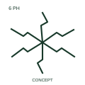

# Six-phase double-zigzag winding connection

This qualifier identifies the publisher's six-phase double-zigzag form with an accessible connection.

[Canonical reference](https://eloragrid.ai/symbols/iec-six-phase-double-zigzag-winding-connection) · [Structured record](../entries/iec-six-phase-double-zigzag-winding-connection.json) · [All references](README.md)

Updated: 2026-10-27. Drawing use: SLD, Schematic. Reference families: IEC, Manufacturer.

Graphical convention: IEC. Six-phase double-zigzag winding connection.

## What it represents

This qualifier identifies the publisher's six-phase double-zigzag form with an accessible connection.
Record the winding sections and common terminal using the actual equipment diagram.
A zigzag connection qualifier does not specify winding turns or grounding duty.

## How to read it

- Record the winding sections and common terminal using the actual equipment diagram.
- A zigzag connection qualifier does not specify winding turns or grounding duty.

## Drawing checklist

- Identify the associated device, circuit or diagram boundary.
- Record the winding sections and common terminal using the actual equipment diagram.
- Cross-reference the equipment data, terminal mapping or operating-state legend needed to interpret the form.

## Important distinction

A zigzag connection qualifier does not specify winding turns or grounding duty.

## Facts

- Reference scope: Specific public IEC-context family form
- Publisher reference token: Q060213 (Autodesk token; not a verified IEC database ID)
- Information added: Record the winding sections and common terminal using the actual equipment diagram.
- Preview: Independent educational concept; consult the publisher and applicable standard for the exact graphic

## Public references

- [AutoCAD Electrical: Winding arrangements and AC/DC indications](https://help.autodesk.com/cloudhelp/2021/ENU/AutoCAD-Electrical/files/GUID-3F5A759D-872A-4990-8AAE-7CCAFBBBD4C5.htm) — Autodesk. Official public publisher family name and reference context; vendor identifiers and graphics are distinct from licensed IEC database content.

## Related references

- [Three-phase motor](motor.md)
- [Generator](generator.md)

Original educational concept geometry, CC BY 4.0. Unitless; not a certified standards glyph or manufacturer footprint.

Elora-authored explanations are CC BY 4.0. Linked standards and manufacturer material retain their own rights. Confirm project requirements using primary sources.
