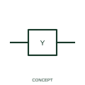

# Solenoid valve actuator

This representation identifies the electrical actuator associated with a solenoid-operated valve.

[Canonical reference](https://eloragrid.ai/symbols/iec-solenoid-valve-actuator) · [Structured record](../entries/iec-solenoid-valve-actuator.json) · [All references](README.md)

Updated: 2026-10-27. Drawing use: Schematic. Reference families: IEC, Manufacturer.

Graphical convention: IEC. Solenoid valve actuator.

## What it represents

This representation identifies the electrical actuator associated with a solenoid-operated valve.
Cross-reference the process valve tag and the actuator's electrical terminals.
A solenoid actuator symbol is not a complete fluid-flow valve diagram.

## How to read it

- Cross-reference the process valve tag and the actuator's electrical terminals.
- A solenoid actuator symbol is not a complete fluid-flow valve diagram.

## Drawing checklist

- Identify the associated device, circuit or diagram boundary.
- Cross-reference the process valve tag and the actuator's electrical terminals.
- Cross-reference the equipment data, terminal mapping or operating-state legend needed to interpret the form.

## Important distinction

A solenoid actuator symbol is not a complete fluid-flow valve diagram.

## Facts

- Reference scope: Specific public IEC-context family form
- Publisher reference token: HSV1, HSVC1 (Autodesk token; not a verified IEC database ID)
- Information added: Cross-reference the process valve tag and the actuator's electrical terminals.
- Preview: Independent educational concept; consult the publisher and applicable standard for the exact graphic

## Public references

- [Autodesk IEC-60617 preview: Solenoid actuator and feedback forms](https://help.autodesk.com/cloudhelp/2021/ENU/AutoCAD-Electrical/files/GUID-A9C3F634-CBD4-4426-8431-1F2AC1B31F7E.htm) — Autodesk. Official public publisher family name and reference context; vendor identifiers and graphics are distinct from licensed IEC database content.

## Related references

- [Relay coil](relay-coil.md)
- [Normally open contact](normally-open-contact.md)

Original educational concept geometry, CC BY 4.0. Unitless; not a certified standards glyph or manufacturer footprint.

Elora-authored explanations are CC BY 4.0. Linked standards and manufacturer material retain their own rights. Confirm project requirements using primary sources.
