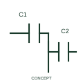

# Split adjustable capacitor

This representation distinguishes the publisher's split and adjustable capacitor form.

[Canonical reference](https://eloragrid.ai/symbols/iec-split-adjustable-capacitor) · [Structured record](../entries/iec-split-adjustable-capacitor.json) · [All references](README.md)

Updated: 2026-10-27. Drawing use: Schematic. Reference families: IEC, Manufacturer.

Graphical convention: IEC. Split adjustable capacitor.

## What it represents

This representation distinguishes the publisher's split and adjustable capacitor form. More than one capacitive section belongs to the publisher’s split adjustable form. The section/common relationships and the coordinated adjustment are part of the circuit interpretation.
Keep separate section connections visible where they serve different circuit paths. The educational preview is not a substitute for the selected component’s terminal arrangement.

## How to read it

- Document the split sections, common electrode and adjustment relationship.
- Multiple capacitive sections must not be collapsed into a single unqualified capacitance value.

## Drawing checklist

- Identify the associated device, circuit or diagram boundary.
- Document the split sections, common electrode and adjustment relationship.
- Cross-reference the equipment data, terminal mapping or operating-state legend needed to interpret the form.

## Important distinction

Multiple capacitive sections must not be collapsed into a single unqualified capacitance value.

## Facts

- Reference scope: Specific public IEC-context family form
- Publisher reference token: HCA1\_S00579 (Autodesk token; not a verified IEC database ID)
- Information added: Document the split sections, common electrode and adjustment relationship.
- Preview: Independent educational concept; consult the publisher and applicable standard for the exact graphic

## Public references

- [Capacitive component symbols](https://help.autodesk.com/cloudhelp/2021/ENU/AutoCAD-Electrical/files/GUID-74580D46-0731-41A6-918D-2DB419114207.htm) — Autodesk. Official public publisher family name and reference context; vendor identifiers and graphics are distinct from licensed IEC database content.

## Related references

- [Resistor](resistor.md)
- [Capacitor](capacitor.md)

Original educational concept geometry, CC BY 4.0. Unitless; not a certified standards glyph or manufacturer footprint.

Elora-authored explanations are CC BY 4.0. Linked standards and manufacturer material retain their own rights. Confirm project requirements using primary sources.
