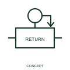

# Spring-return qualifier

A spring-return qualifier indicates return after the specified operating force is removed.

[Canonical reference](https://eloragrid.ai/symbols/iec-spring-return-qualifier) · [Structured record](../entries/iec-spring-return-qualifier.json) · [All references](README.md)

Updated: 2026-10-27. Drawing use: Schematic. Reference families: IEC, Manufacturer.

Graphical convention: IEC. Spring-return qualifier.

## What it represents

A spring-return qualifier indicates return after the specified operating force is removed. Removing the operating force allows the mechanism to return to its specified resting position. A centre-return selector and a returning pushbutton can share this principle while operating different contact sets.
Make the resting position explicit in the position table or legend. If several contacts are linked to the actuator, record their individual states in that resting position.

## How to read it

- Show which position is the resting position and which contacts change during return.
- Spring return does not define whether the resting contacts are open or closed.

## Drawing checklist

- Identify the associated device, circuit or diagram boundary.
- Show which position is the resting position and which contacts change during return.
- Cross-reference the equipment data, terminal mapping or operating-state legend needed to interpret the form.

## Important distinction

Spring return does not define whether the resting contacts are open or closed.

## Facts

- Reference scope: Specific public IEC-context family form
- Publisher reference token: Q070107 (Autodesk token; not a verified IEC database ID)
- Information added: Show which position is the resting position and which contacts change during return.
- Preview: Independent educational concept; consult the publisher and applicable standard for the exact graphic

## Public references

- [Autodesk IEC-60617 preview: Operating-device and function qualifiers](https://help.autodesk.com/cloudhelp/2021/ENU/AutoCAD-Electrical/files/GUID-3598E18D-9F8A-48CE-83D0-4CEBA0AE869C.htm) — Autodesk. Official public publisher family name and reference context; vendor identifiers and graphics are distinct from licensed IEC database content.

## Related references

- [Relay coil](relay-coil.md)
- [Normally open contact](normally-open-contact.md)

Original educational concept geometry, CC BY 4.0. Unitless; not a certified standards glyph or manufacturer footprint.

Elora-authored explanations are CC BY 4.0. Linked standards and manufacturer material retain their own rights. Confirm project requirements using primary sources.
