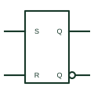

# IEC SR latch (rectangular form)

Rectangular IEC bistable with S and R inputs that set or reset the stored state immediately.

[Canonical reference](https://eloragrid.ai/symbols/iec-sr-latch) · [Structured record](../entries/iec-sr-latch.json) · [All references](README.md)

Updated: 2026-10-28. Drawing use: Schematic. Reference families: IEC, Manufacturer.

Graphical convention: IEC. Rectangular bistable with S and R inputs.

## What it represents

The simplest IEC bistable is a rectangle with inputs labelled S and R and outputs Q and complemented Q. An active S sets the element to 1 and an active R resets it to 0, with no clock involved. Negation or polarity marks show active-low inputs, as on devices built from cross-coupled NAND gates.
SR latches appear in alarm-latching and seal-in logic on control drawings. The key question for a reviewer is what happens when both S and R are active; dependency notation or a note should state whether set or reset dominates.
The symbol does not specify the power-up state. Where it matters, add the I=0 or I=1 qualifier or a note. A separate reset or initialisation circuit is needed when the system requires a defined starting condition.

## How to read it

- Check for active-low marks on S and R.
- Look for a stated set or reset priority.

## Drawing checklist

- Label S and R inside the outline.
- State the priority when both are active.
- Specify the power-up state where relevant.

## Important distinction

A clocked SR flip-flop has 1S and 1R inputs under C1 control; the plain latch has none.

## Facts

- Inputs: S and R, unclocked
- Ambiguity: Both active needs a stated priority
- Artwork scope: Original educational illustration; consult the applicable standard and the selected device documentation for the exact graphic

## Public references

- [Overview of IEEE Standard 91-1984: explanation of logic symbols (SDYZ001A)](https://www.ti.com/lit/ml/sdyz001a/sdyz001a.pdf) — Texas Instruments. Usual meanings of S and R inputs and bistable symbols.
- [SN74LS279A — set-reset latches](https://www.ti.com/product/SN74LS279A) — Texas Instruments. SR latch device documentation.

## Related references

- [Set-reset latch](set-reset-latch.md)
- [IEC set and reset dependency (S, R)](iec-set-reset-dependency.md)
- [ANSI cross-coupled NOR latch](ansi-cross-coupled-nor-latch.md)

Original educational concept geometry, CC BY 4.0. Unitless; not a certified standards glyph or manufacturer footprint.

Elora-authored explanations are CC BY 4.0. Linked standards and manufacturer material retain their own rights. Confirm project requirements using primary sources.
