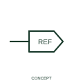

# Standalone destination cross-reference

A destination cross-reference identifies the receiving side of a diagram continuation relationship.

[Canonical reference](https://eloragrid.ai/symbols/iec-standalone-destination-cross-reference) · [Structured record](../entries/iec-standalone-destination-cross-reference.json) · [All references](README.md)

Updated: 2026-10-27. Drawing use: Schematic. Reference families: Manufacturer.

## What it represents

A destination cross-reference identifies the receiving side of a diagram continuation relationship. The destination marks where the referenced circuit or signal continues from its source. The relationship can span sheets without introducing another device or termination.
Check the source tag and the sheet/location reference after drawing changes. An apparently correct arrow can still point to a stale or unrelated continuation.

## How to read it

- Check the source reference and the signal or circuit identity on both sheets.
- A continuation reference does not imply a physical terminal or cable splice.

## Drawing checklist

- Identify the associated device, circuit or diagram boundary.
- Check the source reference and the signal or circuit identity on both sheets.
- Cross-reference the equipment data, terminal mapping or operating-state legend needed to interpret the form.

## Important distinction

A continuation reference does not imply a physical terminal or cable splice.

## Facts

- Reference scope: Publisher drafting annotation / connectivity convention
- Publisher reference token: HA2D1\_REF, HA3D1\_REF, HA5D1\_REF (Autodesk token; not a verified IEC database ID)
- Information added: Check the source reference and the signal or circuit identity on both sheets.
- Preview: Independent educational concept; consult the publisher and applicable standard for the exact graphic

## Public references

- [Autodesk IEC-60617 preview: Standalone source and destination cross-references](https://help.autodesk.com/cloudhelp/2021/ENU/AutoCAD-Electrical/files/GUID-9517DC1C-1B8E-4C09-89EE-433B372FE3ED.htm) — Autodesk. Official public publisher family name and reference context; vendor identifiers and graphics are distinct from licensed IEC database content.

## Related references

- [Terminal connection](terminal.md)
- [Busbar](busbar.md)

Original educational concept geometry, CC BY 4.0. Unitless; not a certified standards glyph or manufacturer footprint.

Elora-authored explanations are CC BY 4.0. Linked standards and manufacturer material retain their own rights. Confirm project requirements using primary sources.
