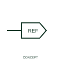

# Standalone source cross-reference

A source cross-reference identifies the originating side of a diagram continuation relationship.

[Canonical reference](https://eloragrid.ai/symbols/iec-standalone-source-cross-reference) · [Structured record](../entries/iec-standalone-source-cross-reference.json) · [All references](README.md)

Updated: 2026-10-27. Drawing use: Schematic. Reference families: Manufacturer.

## What it represents

A source cross-reference identifies the originating side of a diagram continuation relationship. This is a navigation and association element linking a circuit or signal to its continuation. Its source role is meaningful only when the matching destination reference is present.
Use consistent reference text, sheet identifiers and locations at both ends. Cosmetic source shapes do not create different circuit functions.

## How to read it

- Provide the matching destination reference, sheet and location information.
- Rectangle, hexagon and ellipse presentation styles are kept as one source-reference concept.

## Drawing checklist

- Identify the associated device, circuit or diagram boundary.
- Provide the matching destination reference, sheet and location information.
- Cross-reference the equipment data, terminal mapping or operating-state legend needed to interpret the form.

## Important distinction

Rectangle, hexagon and ellipse presentation styles are kept as one source-reference concept.

## Facts

- Reference scope: Publisher drafting annotation / connectivity convention
- Publisher reference token: HA2S1\_REF, HA3S1\_REF, HA5S1\_REF (Autodesk token; not a verified IEC database ID)
- Information added: Provide the matching destination reference, sheet and location information.
- Preview: Independent educational concept; consult the publisher and applicable standard for the exact graphic

## Public references

- [Autodesk IEC-60617 preview: Standalone source and destination cross-references](https://help.autodesk.com/cloudhelp/2021/ENU/AutoCAD-Electrical/files/GUID-9517DC1C-1B8E-4C09-89EE-433B372FE3ED.htm) — Autodesk. Official public publisher family name and reference context; vendor identifiers and graphics are distinct from licensed IEC database content.

## Related references

- [Terminal connection](terminal.md)
- [Busbar](busbar.md)

Original educational concept geometry, CC BY 4.0. Unitless; not a certified standards glyph or manufacturer footprint.

Elora-authored explanations are CC BY 4.0. Linked standards and manufacturer material retain their own rights. Confirm project requirements using primary sources.
