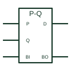

# IEC subtracter (P-Q)

IEC arithmetic element marked P-Q that subtracts word Q from word P, with borrow handling.

[Canonical reference](https://eloragrid.ai/symbols/iec-subtracter) · [Structured record](../entries/iec-subtracter.json) · [All references](README.md)

Updated: 2026-10-28. Drawing use: Schematic. Reference families: IEC, Manufacturer.

Graphical convention: IEC. Rectangular element with the P-Q qualifier.

## What it represents

The subtracter qualifier is written P minus Q. Inputs are grouped as the P and Q words with binary weights and outputs give the difference, with borrow input and output terminals for cascading. TI's overview lists it with the adder and other arithmetic qualifiers.
Dedicated subtracter devices are uncommon; the function is often provided by an adder with an inverted input word or by an arithmetic logic unit. Functional diagrams and programmable logic documentation still use the P-Q element to state intent clearly.
The symbol does not say whether the result is signed or how negative results are represented. State that in the logic description.

## How to read it

- P is the minuend and Q the subtrahend.
- Check borrow terminals when cascading.

## Drawing checklist

- Mark the element P-Q.
- Group and weight both words.
- Describe the result representation.

## Important distinction

The Σ adder adds P and Q; an ALU may perform either under mode control.

## Facts

- Qualifier: P-Q
- Common implementation: Adder with complemented input or ALU
- Artwork scope: Original educational illustration; consult the applicable standard and the selected device documentation for the exact graphic

## Public references

- [Overview of IEEE Standard 91-1984: explanation of logic symbols (SDYZ001A)](https://www.ti.com/lit/ml/sdyz001a/sdyz001a.pdf) — Texas Instruments. Lists P-Q as the subtracter qualifier.

## Related references

- [IEC adder (Σ)](iec-full-adder.md)
- [IEC arithmetic logic unit (ALU)](iec-arithmetic-logic-unit.md)
- [Binary full adder](binary-full-adder.md)

Original educational concept geometry, CC BY 4.0. Unitless; not a certified standards glyph or manufacturer footprint.

Elora-authored explanations are CC BY 4.0. Linked standards and manufacturer material retain their own rights. Confirm project requirements using primary sources.
