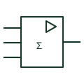

# IEC summing amplifier element (Σ)

Analogue element with Σ and several inputs, producing an output proportional to the weighted sum of the inputs.

[Canonical reference](https://eloragrid.ai/symbols/iec-summing-amplifier) · [Structured record](../entries/iec-summing-amplifier.json) · [All references](README.md)

Updated: 2026-10-28. Drawing use: Schematic. Reference families: IEC, Manufacturer.

Graphical convention: IEC. Rectangular analogue element with Σ function and several weighted inputs.

## What it represents

A summing amplifier adds several analogue inputs, each with its own weighting. In IEC-style analogue element diagrams it is drawn as a rectangle with an amplifier mark and the Σ function, with weighting factors written next to each input. The usual circuit realisation is an inverting op-amp with one input resistor per signal.
Summers appear in control loops for combining set-point and feedforward signals, in audio-style mixing of measurements, and in analogue computation. The weighting factors and the sign of the output must be stated because an inverting realisation reverses polarity.
The element does not show the resistor network that sets the weights. For a construction schematic, the op-amp circuit with values should be drawn or referenced.

## How to read it

- Weighting factors are written beside the inputs.
- An inverting realisation gives a negative sum unless followed by an inverter.

## Drawing checklist

- State each input weight.
- State output sign.
- Reference the implementing op-amp circuit.

## Important distinction

The digital Σ adder adds binary words; the analogue summing element adds voltages or currents.

## Facts

- Function: Weighted sum of inputs
- Typical realisation: Inverting op-amp with one resistor per input
- Artwork scope: Original educational illustration; consult the applicable standard and the selected device documentation for the exact graphic

## Public references

- [IEC graphical symbols for diagrams](https://tc3.iec.ch/tc-activity/graphical-symbols-for-diagrams/) — IEC. IEC graphical symbols programme covering analogue elements; no geometry reproduced.
- [University tutorials: amplifier configurations and signal processing](https://wiki.analog.com/university/courses/tutorials/index) — Analog Devices. Public tutorial material on op-amp configurations including summing circuits.

## Related references

- [IEC operational amplifier (rectangular form)](iec-operational-amplifier.md)
- [Inverting amplifier circuit](inverting-amplifier-circuit.md)
- [IEC integrator element (∫)](iec-integrator.md)

Original educational concept geometry, CC BY 4.0. Unitless; not a certified standards glyph or manufacturer footprint.

Elora-authored explanations are CC BY 4.0. Linked standards and manufacturer material retain their own rights. Confirm project requirements using primary sources.
