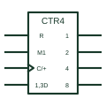

# IEC synchronous binary counter (CTRm)

IEC counter marked CTRm, where m is the bit count and the cycle length is 2 to the power m.

[Canonical reference](https://eloragrid.ai/symbols/iec-synchronous-binary-counter) · [Structured record](../entries/iec-synchronous-binary-counter.json) · [All references](README.md)

Updated: 2026-10-28. Drawing use: Schematic. Reference families: IEC, Manufacturer.

Graphical convention: IEC. Rectangular element with CTRm qualifier, common-control block and weighted outputs.

## What it represents

The general qualifier CTRm identifies a counter with m bits and a cycle length of 2 to the power m. In IEC form the clock appears as C with a + to show counting up, and load, clear and enable inputs use dependency notation such as M1 for load mode and G for count enable. Outputs carry binary weights 1, 2, 4 and 8.
A reader should identify the synchronous and asynchronous inputs from their prefixes, then find the carry output, often labelled CT=15, used to cascade stages. On control drawings counters represent event totals, batch counts or divide-by-n timing.
The symbol does not state maximum count rate or whether the clear is synchronous, except through dependency labels. Read the prefixes carefully.

## How to read it

- CTRm gives the bit count; the cycle is 2 to the power m.
- CT=15 marks the terminal-count output used for cascading.

## Drawing checklist

- State the bit count in the qualifier.
- Label load, clear and enable with dependency notation.
- Show cascade connections between stages.

## Important distinction

CTR DIVm states the cycle length directly and is used for non-binary counters such as decade counters.

## Facts

- Qualifier: CTRm
- Cycle length: 2 to the power m
- Artwork scope: Original educational illustration; consult the applicable standard and the selected device documentation for the exact graphic

## Public references

- [Overview of IEEE Standard 91-1984: explanation of logic symbols (SDYZ001A)](https://www.ti.com/lit/ml/sdyz001a/sdyz001a.pdf) — Texas Instruments. Lists CTRm and related counter qualifiers and the contents output CT=.
- [SN74HC163 — synchronous binary counters](https://www.ti.com/lit/ds/symlink/sn74hc163.pdf) — Texas Instruments. Synchronous binary counter documentation.

## Related references

- [Synchronous binary counter](synchronous-binary-counter.md)
- [IEC decade counter (CTR DIV10)](iec-decade-counter.md)
- [IEC ripple counter (RCTRm)](iec-ripple-counter.md)

Original educational concept geometry, CC BY 4.0. Unitless; not a certified standards glyph or manufacturer footprint.

Elora-authored explanations are CC BY 4.0. Linked standards and manufacturer material retain their own rights. Confirm project requirements using primary sources.
