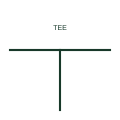

# T-connection without junction dot

A conductor meeting another at a right angle and stopping there, which IEC practice reads as a connection even without a dot.

[Canonical reference](https://eloragrid.ai/symbols/iec-t-connection-without-dot) · [Structured record](../entries/iec-t-connection-without-dot.json) · [All references](README.md)

Updated: 2026-10-28. Drawing use: Schematic, SLD. Reference families: IEC.

Graphical convention: IEC. Undotted T-connection.

## What it represents

In IEC drawing practice a conductor that runs into another and ends there forms a T-connection, and the connection is understood whether or not a dot is drawn. Many drafting standards still recommend the dot for clarity, but undotted tees are common on legacy and vendor drawings.
The convention depends on the drawing family. On some ANSI-style drawings an undotted tee may be ambiguous, which is why a dot is preferred there. Readers should check the drawing legend. A T-connection only shows electrical continuity; it does not tell you where the physical joint is, which may be at a terminal some distance away.

## How to read it

- Check the legend to see whether undotted tees are used as connections.
- Find the physical terminal or joint that realises the tee.

## Drawing checklist

- Apply one tee convention consistently across the set.
- Prefer a dot where drawings may be read under other conventions.
- Avoid four-way crossings that rely on dots alone.

## Important distinction

An undotted tee is a connection; a plain four-way crossing without a dot is normally read as no connection.

## Facts

- Graphic cue: Conductor ending perpendicular on another without a dot
- Reading rule: Connected under IEC practice; check legend for other conventions
- Preview: Original educational illustration; consult the publisher and applicable standard for the exact graphic

## Public references

- [Wire connection dots, crossing gaps and loops](https://help.autodesk.com/cloudhelp/2020/ENU/AutoCAD-Electrical/files/GUID-936BB8A9-9C01-4AC6-B833-CB97700A7203.htm) — Autodesk. Public guidance on connection dots, crossing gaps and loops.
- [IEC-60617 symbol preview directory](https://help.autodesk.com/cloudhelp/2021/ENU/AutoCAD-Electrical/files/GUID-7871E6EF-24D5-467E-9B74-321FEDC9DFDA.htm) — Autodesk. Public directory of IEC-oriented symbol families.

## Related references

- [Conductor connection junction](iec-conductor-connection-junction.md)
- [Double junction of conductors](iec-double-junction.md)
- [ANSI/IEEE conductor junction symbol](ansi-conductor-junction.md)

Original educational concept geometry, CC BY 4.0. Unitless; not a certified standards glyph or manufacturer footprint.

Elora-authored explanations are CC BY 4.0. Linked standards and manufacturer material retain their own rights. Confirm project requirements using primary sources.
