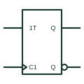

# IEC T (toggle) flip-flop

IEC bistable with a 1T toggle input; when T is active, each clock edge changes the stored state.

[Canonical reference](https://eloragrid.ai/symbols/iec-t-flip-flop) · [Structured record](../entries/iec-t-flip-flop.json) · [All references](README.md)

Updated: 2026-10-28. Drawing use: Schematic. Reference families: IEC, Manufacturer.

Graphical convention: IEC. Rectangular bistable with 1T and dynamic C1 inputs.

## What it represents

The toggle input T causes the internal state to change to its complement. In IEC form it is labelled 1T when controlled by a C1 clock, or drawn as a single dynamic T input where each transition toggles. A T stage is the basic divide-by-two element in counters and frequency dividers.
Dedicated T flip-flop packages are rare; the function is usually built from a JK with J and K tied high or a D flip-flop with its complemented output fed back. Functional logic drawings, PLC function-block diagrams and FPGA documentation still use the T form because it states the intent clearly.
The symbol does not show how the toggle function is implemented. Where a JK or D device is used, the physical wiring should appear on the detailed schematic.

## How to read it

- Read T as change state on each enabled clock.
- Check the implementation on the detailed schematic.

## Drawing checklist

- Label the toggle input as 1T with a C1 clock, or as a dynamic T.
- Show initial state where required.
- Cross-reference the implementing JK or D device.

## Important distinction

A JK flip-flop provides set, reset, hold and toggle; a T element provides only hold and toggle.

## Facts

- Function: Toggle on each enabled clock
- Typical use: Divide-by-two, counter stage
- Artwork scope: Original educational illustration; consult the applicable standard and the selected device documentation for the exact graphic

## Public references

- [Overview of IEEE Standard 91-1984: explanation of logic symbols (SDYZ001A)](https://www.ti.com/lit/ml/sdyz001a/sdyz001a.pdf) — Texas Instruments. Defines the T toggle input.

## Related references

- [IEC JK flip-flop (rectangular form)](iec-jk-flip-flop.md)
- [IEC ripple counter (RCTRm)](iec-ripple-counter.md)
- [Positive-edge D flip-flop](positive-edge-d-flip-flop.md)

Original educational concept geometry, CC BY 4.0. Unitless; not a certified standards glyph or manufacturer footprint.

Elora-authored explanations are CC BY 4.0. Linked standards and manufacturer material retain their own rights. Confirm project requirements using primary sources.
