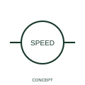

# Tachometric dynamo

A tachometric dynamo indication identifies a speed-related generating measurement function.

[Canonical reference](https://eloragrid.ai/symbols/iec-tachometric-dynamo) · [Structured record](../entries/iec-tachometric-dynamo.json) · [All references](README.md)

Updated: 2026-10-27. Drawing use: Schematic. Reference families: IEC, Manufacturer.

Graphical convention: IEC. Tachometric dynamo.

## What it represents

A tachometric dynamo indication identifies a speed-related generating measurement function.
Document shaft relationship, output signal and instrument interface.
A speed-measurement generator differs from a power-generating machine.

## How to read it

- Document shaft relationship, output signal and instrument interface.
- A speed-measurement generator differs from a power-generating machine.

## Drawing checklist

- Identify the associated device, circuit or diagram boundary.
- Document shaft relationship, output signal and instrument interface.
- Cross-reference the equipment data, terminal mapping or operating-state legend needed to interpret the form.

## Important distinction

A speed-measurement generator differs from a power-generating machine.

## Facts

- Reference scope: Specific public IEC-context family form
- Publisher reference token: HIN1B11 (Autodesk token; not a verified IEC database ID)
- Information added: Document shaft relationship, output signal and instrument interface.
- Preview: Independent educational concept; consult the publisher and applicable standard for the exact graphic

## Public references

- [AutoCAD Electrical: Instrumentation and sensors](https://help.autodesk.com/cloudhelp/2021/ENU/AutoCAD-Electrical/files/GUID-773A36C3-44C6-43EB-9BD0-E0297816B9B2.htm) — Autodesk. Official public publisher family name and reference context; vendor identifiers and graphics are distinct from licensed IEC database content.

## Related references

- [Current transformer](current-transformer.md)
- [Voltage transformer](voltage-transformer.md)

Original educational concept geometry, CC BY 4.0. Unitless; not a certified standards glyph or manufacturer footprint.

Elora-authored explanations are CC BY 4.0. Linked standards and manufacturer material retain their own rights. Confirm project requirements using primary sources.
