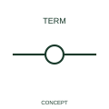

# Terminal carrying wire identification

This terminal representation carries the associated wire identifier at the connection point.

[Canonical reference](https://eloragrid.ai/symbols/iec-terminal-carrying-wire-identification) · [Structured record](../entries/iec-terminal-carrying-wire-identification.json) · [All references](README.md)

Updated: 2026-10-27. Drawing use: Schematic. Reference families: IEC, Manufacturer.

Graphical convention: IEC. Terminal carrying wire identification.

## What it represents

This terminal representation carries the associated wire identifier at the connection point.
Distinguish the wire identifier from the terminal position number in the schedule.
A wire number and a terminal number should not be substituted for each other.

## How to read it

- Distinguish the wire identifier from the terminal position number in the schedule.
- A wire number and a terminal number should not be substituted for each other.

## Drawing checklist

- Identify the associated device, circuit or diagram boundary.
- Distinguish the wire identifier from the terminal position number in the schedule.
- Cross-reference the equipment data, terminal mapping or operating-state legend needed to interpret the form.

## Important distinction

A wire number and a terminal number should not be substituted for each other.

## Facts

- Reference scope: Specific public IEC-context family form
- Publisher reference token: HT0W02 (Autodesk token; not a verified IEC database ID)
- Information added: Distinguish the wire identifier from the terminal position number in the schedule.
- Preview: Independent educational concept; consult the publisher and applicable standard for the exact graphic

## Public references

- [Terminal symbol and numbering variants](https://help.autodesk.com/cloudhelp/2021/ENU/AutoCAD-Electrical/files/GUID-AC31431B-1EB8-492C-8201-B09DE3A4D8A3.htm) — Autodesk. Official public publisher family name and reference context; vendor identifiers and graphics are distinct from licensed IEC database content.

## Related references

- [Terminal connection](terminal.md)
- [Busbar](busbar.md)

Original educational concept geometry, CC BY 4.0. Unitless; not a certified standards glyph or manufacturer footprint.

Elora-authored explanations are CC BY 4.0. Linked standards and manufacturer material retain their own rights. Confirm project requirements using primary sources.
