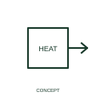

# Thermal-effect qualifier

A thermal-effect qualifier identifies a function responding to or producing heat-related behaviour.

[Canonical reference](https://eloragrid.ai/symbols/iec-thermal-effect-qualifier) · [Structured record](../entries/iec-thermal-effect-qualifier.json) · [All references](README.md)

Updated: 2026-10-27. Drawing use: Schematic. Reference families: IEC, Manufacturer.

Graphical convention: IEC. Thermal-effect qualifier.

## What it represents

A thermal-effect qualifier identifies a function responding to or producing heat-related behaviour.
State whether temperature is the initiating condition or an output effect.
A thermal qualifier is different from a complete temperature sensor or a trip-setting value.

## How to read it

- State whether temperature is the initiating condition or an output effect.
- A thermal qualifier is different from a complete temperature sensor or a trip-setting value.

## Drawing checklist

- Identify the associated device, circuit or diagram boundary.
- State whether temperature is the initiating condition or an output effect.
- Cross-reference the equipment data, terminal mapping or operating-state legend needed to interpret the form.

## Important distinction

A thermal qualifier is different from a complete temperature sensor or a trip-setting value.

## Facts

- Reference scope: Specific public IEC-context family form
- Publisher reference token: Q020801 (Autodesk token; not a verified IEC database ID)
- Information added: State whether temperature is the initiating condition or an output effect.
- Preview: Independent educational concept; consult the publisher and applicable standard for the exact graphic

## Public references

- [Autodesk IEC-60617 preview: Physical-effect qualifiers](https://help.autodesk.com/cloudhelp/2021/ENU/AutoCAD-Electrical/files/GUID-415094F8-A451-4C12-92F0-EF3890FBED72.htm) — Autodesk. Official public publisher family name and reference context; vendor identifiers and graphics are distinct from licensed IEC database content.

## Related references

- [Relay coil](relay-coil.md)
- [Normally open contact](normally-open-contact.md)

Original educational concept geometry, CC BY 4.0. Unitless; not a certified standards glyph or manufacturer footprint.

Elora-authored explanations are CC BY 4.0. Linked standards and manufacturer material retain their own rights. Confirm project requirements using primary sources.
