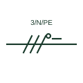

# Three-phase circuit with neutral and PE marking

A single-line notation such as 3/N/PE showing a three-phase circuit carrying both a neutral and a separate protective conductor.

[Canonical reference](https://eloragrid.ai/symbols/iec-three-phase-five-wire-marking) · [Structured record](../entries/iec-three-phase-five-wire-marking.json) · [All references](README.md)

Updated: 2026-10-28. Drawing use: SLD. Reference families: IEC.

Graphical convention: IEC. Conductor complement notation on a single line.

## What it represents

Single-line diagrams often state the conductor complement of a circuit with a short notation beside the line, for example 3/N/PE 400/230 V 50 Hz. This tells the reader at a glance that the circuit has three phases, a neutral and a separate protective conductor, which is the normal TN-S final distribution arrangement.
The notation is a statement about which conductors exist, not their sizes. It also does not confirm that the downstream equipment uses the neutral. Changes in the notation along a feeder, for example from 3/PEN to 3/N/PE, mark the point where a PEN conductor has been split.

## How to read it

- Watch for a change in notation along a feeder that marks a PEN split.
- Read voltage and frequency that may follow the conductor notation.

## Drawing checklist

- State the conductor complement on each distribution feeder.
- Include voltage and frequency where the notation is used.
- Keep notation consistent with the cable schedule.

## Important distinction

The 3/N/PE notation states a whole conductor complement; individual N, PE or PEN marks identify one conductor on a stroke.

## Facts

- Typical text: 3/N/PE 400/230 V 50 Hz
- Scheme context: TN-S distribution
- Preview: Original educational illustration; consult the publisher and applicable standard for the exact graphic

## Public references

- [Definition of standardised earthing schemes](https://www.electrical-installation.org/enwiki/Definition_of_standardised_earthing_schemes) — Schneider Electric, Electrical Installation Guide. Public installation-guide definitions of earthing schemes.
- [IEC-60617 symbol preview directory](https://help.autodesk.com/cloudhelp/2021/ENU/AutoCAD-Electrical/files/GUID-7871E6EF-24D5-467E-9B74-321FEDC9DFDA.htm) — Autodesk. Public directory of IEC-oriented symbol families.

## Related references

- [Neutral conductor mark](iec-neutral-conductor-mark.md)
- [Protective conductor mark](iec-protective-conductor-mark.md)
- [Conductor count by numeral](conductor-count-numeral.md)

Original educational concept geometry, CC BY 4.0. Unitless; not a certified standards glyph or manufacturer footprint.

Elora-authored explanations are CC BY 4.0. Linked standards and manufacturer material retain their own rights. Confirm project requirements using primary sources.
