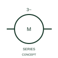

# Three-phase induction motor with series excitation

This representation identifies the publisher's asynchronous motor form with series excitation.

[Canonical reference](https://eloragrid.ai/symbols/iec-three-phase-induction-motor-with-series-excitation) · [Structured record](../entries/iec-three-phase-induction-motor-with-series-excitation.json) · [All references](README.md)

Updated: 2026-10-27. Drawing use: SLD, Schematic. Reference families: IEC, Manufacturer.

Graphical convention: IEC. Three-phase induction motor with series excitation.

## What it represents

This representation identifies the publisher's asynchronous motor form with series excitation.
Document stator, excitation and any associated control connections separately.
The reference form does not identify a conventional squirrel-cage motor without an excitation circuit.

## How to read it

- Document stator, excitation and any associated control connections separately.
- The reference form does not identify a conventional squirrel-cage motor without an excitation circuit.

## Drawing checklist

- Identify the associated device, circuit or diagram boundary.
- Document stator, excitation and any associated control connections separately.
- Cross-reference the equipment data, terminal mapping or operating-state legend needed to interpret the form.

## Important distinction

The reference form does not identify a conventional squirrel-cage motor without an excitation circuit.

## Facts

- Reference scope: Specific public IEC-context family form
- Publisher reference token: HMO1M3 (Autodesk token; not a verified IEC database ID)
- Information added: Document stator, excitation and any associated control connections separately.
- Preview: Independent educational concept; consult the publisher and applicable standard for the exact graphic

## Public references

- [Three-phase motor symbol variants](https://help.autodesk.com/cloudhelp/2021/ENU/AutoCAD-Electrical/files/GUID-385CBE83-33A3-4314-913E-3B59A6D05F22.htm) — Autodesk. Official public publisher family name and reference context; vendor identifiers and graphics are distinct from licensed IEC database content.

## Related references

- [Three-phase motor](motor.md)
- [Generator](generator.md)

Original educational concept geometry, CC BY 4.0. Unitless; not a certified standards glyph or manufacturer footprint.

Elora-authored explanations are CC BY 4.0. Linked standards and manufacturer material retain their own rights. Confirm project requirements using primary sources.
