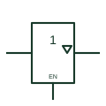

# IEC three-state buffer (rectangular form)

IEC buffer whose output carries the three-state triangle and is controlled by an EN input.

[Canonical reference](https://eloragrid.ai/symbols/iec-three-state-buffer) · [Structured record](../entries/iec-three-state-buffer.json) · [All references](README.md)

Updated: 2026-10-28. Drawing use: Schematic. Reference families: IEC, Manufacturer.

Graphical convention: IEC. 1 element with EN input and inverted-triangle three-state output qualifier.

## What it represents

The three-state buffer is drawn as a 1 element with a small downward triangle inside the outline next to the output, and an EN input. When EN is at its internal 1 state the output follows the input; at its internal 0 state the output goes to its external high-impedance state while the internal logic state is retained.
These elements appear where several drivers share a bus, such as data lines between controller cards. The drawing should make clear which signal drives each EN input and how the design prevents two drivers being enabled together, since the symbol itself does not show arbitration.
A negated EN input means the enable is active low, which is how many devices are supplied. Read the input marking carefully; reversing the enable sense would put a buffer on the bus at the wrong time.

## How to read it

- Find the EN input and check its polarity.
- Identify all other drivers on the same bus.

## Drawing checklist

- Place the three-state triangle next to the output.
- Label the EN input and its source.
- Show bus contention protection or a note on enable sequencing.

## Important distinction

An open-circuit output uses a diamond qualifier and has no high-impedance logic state of its own; the three-state triangle is different.

## Facts

- Output qualifier: Downward triangle (three-state)
- EN at internal 0: Output at external high impedance
- Artwork scope: Original educational illustration; consult the applicable standard and the selected device documentation for the exact graphic

## Public references

- [Overview of IEEE Standard 91-1984: explanation of logic symbols (SDYZ001A)](https://www.ti.com/lit/ml/sdyz001a/sdyz001a.pdf) — Texas Instruments. Explains the three-state qualifier and EN input effects.
- [SN74HC125 — three-state buffers](https://www.ti.com/lit/ds/symlink/sn74hc125.pdf) — Texas Instruments. Manufacturer three-state buffer documentation.

## Related references

- [Three-state logic buffer](logic-three-state-buffer.md)
- [IEC three-state output qualifier](iec-three-state-output-qualifier.md)
- [IEC enable input (EN)](iec-enable-input.md)

Original educational concept geometry, CC BY 4.0. Unitless; not a certified standards glyph or manufacturer footprint.

Elora-authored explanations are CC BY 4.0. Linked standards and manufacturer material retain their own rights. Confirm project requirements using primary sources.
