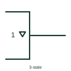

# IEC three-state output qualifier

Downward triangle inside an outline marking an output that can enter a high-impedance state.

[Canonical reference](https://eloragrid.ai/symbols/iec-three-state-output-qualifier) · [Structured record](../entries/iec-three-state-output-qualifier.json) · [All references](README.md)

Updated: 2026-10-28. Drawing use: Schematic. Reference families: IEC, Manufacturer.

Graphical convention: IEC. Small downward-pointing triangle inside the outline at the output.

## What it represents

The three-state qualifier is a small triangle pointing downwards, drawn inside the outline next to the output. It says the output has a third, high-impedance state in addition to high and low. The output is controlled by an EN input or by EN dependency.
Wherever this qualifier appears, the reader should find the controlling EN input and confirm that only one driver on the net can be enabled at once. On bus diagrams the qualifier is often shown on only the first element of an array to reduce clutter.
The qualifier does not indicate bus hold or default level when all drivers are off. A floating bus needs pull resistors or bus-keeper circuitry shown separately.

## How to read it

- Find the EN input or EN dependency label that controls the output.
- In arrays, the qualifier may appear only on the first element.

## Drawing checklist

- Place the triangle inside the outline next to the output.
- Show the enable source.
- Show bus defaulting components where needed.

## Important distinction

The open-circuit diamond indicates a stage that is off in one level, not a controlled high-impedance state.

## Facts

- States: High, low and high impedance
- Controlled by: EN input or EN dependency
- Artwork scope: Original educational illustration; consult the applicable standard and the selected device documentation for the exact graphic

## Public references

- [Overview of IEEE Standard 91-1984: explanation of logic symbols (SDYZ001A)](https://www.ti.com/lit/ml/sdyz001a/sdyz001a.pdf) — Texas Instruments. Defines the three-state output qualifier and EN effects.

## Related references

- [IEC three-state buffer (rectangular form)](iec-three-state-buffer.md)
- [IEC enable input (EN)](iec-enable-input.md)
- [Three-state logic buffer](logic-three-state-buffer.md)

Original educational concept geometry, CC BY 4.0. Unitless; not a certified standards glyph or manufacturer footprint.

Elora-authored explanations are CC BY 4.0. Linked standards and manufacturer material retain their own rights. Confirm project requirements using primary sources.
