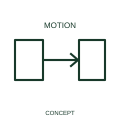

# Transition indication

A transition indication identifies a documented change between positions or states.

[Canonical reference](https://eloragrid.ai/symbols/iec-transition-indication) · [Structured record](../entries/iec-transition-indication.json) · [All references](README.md)

Updated: 2026-10-27. Drawing use: Schematic. Reference families: IEC, Manufacturer.

Graphical convention: IEC. Transition indication.

## What it represents

A transition indication identifies a documented change between positions or states. A transition describes movement between documented states rather than a steady-state position. Its meaning depends on the source state, destination state and initiating event.
In a sequence or operating-state drawing, retain those state labels close to the transition. An electrical contact diagram still needs its own normal-state convention.

## How to read it

- Define the states and the event that causes the transition in the diagram context.
- A transition annotation is distinct from a steady-state device symbol.

## Drawing checklist

- Identify the associated device, circuit or diagram boundary.
- Define the states and the event that causes the transition in the diagram context.
- Cross-reference the equipment data, terminal mapping or operating-state legend needed to interpret the form.

## Important distinction

A transition annotation is distinct from a steady-state device symbol.

## Facts

- Reference scope: Specific public IEC-context family form
- Publisher reference token: Q101101 (Autodesk token; not a verified IEC database ID)
- Information added: Define the states and the event that causes the transition in the diagram context.
- Preview: Independent educational concept; consult the publisher and applicable standard for the exact graphic

## Public references

- [Autodesk IEC-60617 preview: Linear force and motion qualifiers](https://help.autodesk.com/cloudhelp/2021/ENU/AutoCAD-Electrical/files/GUID-D3F1AA20-F564-40CC-97D3-21EBA20E717A.htm) — Autodesk. Official public publisher family name and reference context; vendor identifiers and graphics are distinct from licensed IEC database content.

## Related references

- [Relay coil](relay-coil.md)
- [Normally open contact](normally-open-contact.md)

Original educational concept geometry, CC BY 4.0. Unitless; not a certified standards glyph or manufacturer footprint.

Elora-authored explanations are CC BY 4.0. Linked standards and manufacturer material retain their own rights. Confirm project requirements using primary sources.
