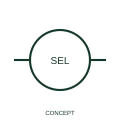

# Two-network voltage measurement selector

This representation distinguishes voltage selection between two three-phase networks.

[Canonical reference](https://eloragrid.ai/symbols/iec-two-network-voltage-measurement-selector) · [Structured record](../entries/iec-two-network-voltage-measurement-selector.json) · [All references](README.md)

Updated: 2026-10-27. Drawing use: Schematic. Reference families: IEC, Manufacturer.

Graphical convention: IEC. Two-network voltage measurement selector.

## What it represents

This representation distinguishes voltage selection between two three-phase networks. The measurement is selected from more than one network or bus system. Both source identities must remain visible so that a reading is not attributed to the wrong supply.
Tag the two measurement sources and provide a position table with each voltage pair. This selector does not create a load-supply transfer arrangement between the networks.

## How to read it

- Identify both sources and each selectable measurement connection.
- Measurement selection between networks is not an automatic source-transfer power switch.

## Drawing checklist

- Identify the associated device, circuit or diagram boundary.
- Identify both sources and each selectable measurement connection.
- Cross-reference the equipment data, terminal mapping or operating-state legend needed to interpret the form.

## Important distinction

Measurement selection between networks is not an automatic source-transfer power switch.

## Facts

- Reference scope: Specific public IEC-context family form
- Publisher reference token: HSW1S93 (Autodesk token; not a verified IEC database ID)
- Information added: Identify both sources and each selectable measurement connection.
- Preview: Independent educational concept; consult the publisher and applicable standard for the exact graphic

## Public references

- [AutoCAD Electrical: Level, flow, keyed and measurement switches](https://help.autodesk.com/cloudhelp/2021/ENU/AutoCAD-Electrical/files/GUID-1FB94435-C954-4479-BD97-25796DB8F728.htm) — Autodesk. Official public publisher family name and reference context; vendor identifiers and graphics are distinct from licensed IEC database content.

## Related references

- [Current transformer](current-transformer.md)
- [Voltage transformer](voltage-transformer.md)

Original educational concept geometry, CC BY 4.0. Unitless; not a certified standards glyph or manufacturer footprint.

Elora-authored explanations are CC BY 4.0. Linked standards and manufacturer material retain their own rights. Confirm project requirements using primary sources.
